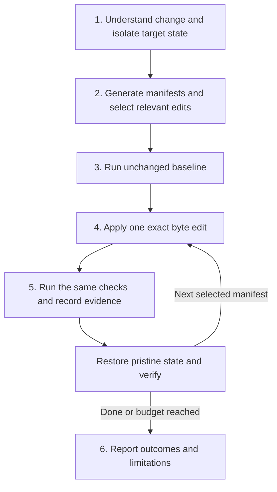

# Change-focused mutation testing

Act as the mutation executor; do not ask the user to apply edits or run tests manually. Atlas supplies independent single-edit manifests, not a test runner or an outcome ledger. Use the available tools to execute this workflow and report the results. Ask only when the change scope, required command, permissions, or safe environment cannot be established.

## 1. Establish the change and execution boundary

Read the target project's instructions and inspect its Git status, diff, relevant source and tests. Identify the requested comparison base and target revision. For a PR, compare its base with the proposed code using the merge base; for uncommitted work, include staged and unstaged changes and relevant untracked files. Do not silently substitute the last commit for the requested change.

Record the comparison, target revision, affected behavior and test commands. Derive commands from project instructions, CI and package configuration; do not guess a universal test command. Choose a bounded candidate count and per-command timeout before running, using the user's budget or a small default of at most five relevant mutants. Explain any time-based cutoff.

Use an agent-owned temporary detached Git worktree or disposable copy of the exact target state. A worktree at HEAD does not include uncommitted edits: if needed, transfer a reviewed patch and relevant untracked files into isolation, preserving their paths and bytes, and verify the resulting source matches the intended state. Never transfer secrets, ignored environments or unrelated user files. If the target state cannot be reproduced safely, stop and explain.

Keep logs, manifests and a pristine snapshot outside the test source tree. Do not mutate the user's checkout, reset/stash their edits, commit experimental mutations, or push them. Restrict execution to approved local test commands. Isolation by worktree is not a security sandbox: avoid production services, credentials, destructive integrations and network side effects; request permission if safe execution is unclear.



## 2. Generate and select relevant manifests

Use `atlas` if installed. In an Atlas checkout, use `uv run --project /absolute/path/to/atlas/atlas atlas`; keep that tool path fixed when analyzing another project. Inspect `atlas mutations --help`, `atlas mutations --rules`, and the installed version's configuration contract before configuring rules. Different revisions may use different configuration shapes; do not copy a format blindly.

Run fresh analysis against the entire isolated project, not only the changed files:

```sh
atlas mutations --rules
atlas mutations -f /absolute/path/to/isolated-project > /absolute/path/to/run-artifacts/manifests.json
```

If rules are absent or insufficient, enable only catalog-supported rules needed for this experiment in the isolated project's `atlas.json`, preserving existing settings. Record this temporary configuration separately from production edits. Do not change configuration in the user's checkout. Prefer fresh analysis; `--saved` requires matching indexed candidates and never refreshes them. Do not initialize or write an index merely for this workflow.

Select candidates by **behavioral relevance to the change**, not by availability or proximity alone. For every selected manifest, record:

- The changed requirement or behavior it probes, with diff/source evidence.
- Why this exact operator replacement models a plausible regression.
- Which existing tests should detect it, and the expected failing assertion or observable difference.

Prioritize edits inside changed expressions, then directly affected callers/callees or guards when source evidence connects them to the change. An unchanged boundary comparison can be relevant to a new boundary test; unrelated arithmetic in the same file is not. Test-only changes can justify mutations in the production behavior those tests exercise. Do not mutate test code, generated/vendor files, or unrelated functions merely to increase the count. Do not infer runtime reachability from an import alone.

Example: a change to discount eligibility at an age threshold justifies mutating the eligibility `<` comparison to `<=` to probe the boundary. It does not justify changing a logging counter's `+` to `-` elsewhere in that file.

Skip irrelevant, duplicate, clearly equivalent or unsafe proposals and explain representative exclusions. If no supported manifest probes the changed behavior, report **no relevant candidates**, not success or a reason to mutate unrelated code. Do not invent arbitrary edits outside the catalog. Treat equivalence as a claim requiring evidence, not as a default explanation for a survivor.

## 3. Establish a passing baseline

Prepare dependencies and build artifacts inside isolation using the project's normal setup. Run the exact checks intended for every mutant on the unchanged target state. Capture command, working directory, exit status, duration and full output outside the source tree. Set an explicit timeout and ensure timed-out child processes are stopped before restoring files.

At minimum, run the relevant tests; include required compilation/build steps. Discover the real test runner and ensure tests were collected and executed: zero tests or a skipped suite is not a passing baseline. If the baseline fails, times out, or is flaky, stop mutation execution and report it as blocked. Do not classify pre-existing failures as killed mutants. Keep the same commands and environment for the baseline and every mutant; if they change, establish a new baseline.

## 4. Apply one manifest exactly

Start each experiment from the same pristine isolated target state. Verify the manifest path resolves inside that root, reject escaping paths/symlinks, and read the file as bytes. Verify its full SHA-256 equals `sourceHash`. Decode the base64 `originalBytes` and `replacementBytes`; verify the half-open `[span.startByte, span.endByte)` slice equals the original bytes.

Construct precisely:

```python
mutated = original[:start_byte] + replacement_bytes + original[end_byte:]
```

Write only that one byte edit in isolation. Do not use global text replacement, character offsets, newline normalization, or compose manifests. Verify the resulting bytes equal the construction above and inspect the diff before executing. On a hash/span mismatch, stop using that manifest and regenerate from the pristine target; never adjust offsets by guesswork.

## 5. Execute, classify and restore

Run the same baseline checks with the same timeout. Capture manifest/candidate IDs, path/span, rule, exact before/after edit, relevance rationale, command, exit status, duration, log path and outcome. Distinguish:

| Outcome | Required evidence |
| --- | --- |
| Killed | Baseline passed; a test assertion/behavior check now fails because of this mutation. Cite the failing test and output. |
| Survived | The same checks completed successfully with tests actually executed. This is a possible gap, not proof of equivalence. |
| Invalid | The mutation causes a syntax/type/compile failure. Keep separate from assertion-based kills. |
| Timeout | The time limit expired. Do not count as killed without further evidence. |
| Inconclusive | Infrastructure/setup failure, flaky result, uncertain attribution, or no tests executed. |
| Skipped | Not run; give the relevance, safety or budget reason. |

Never classify a nonzero exit code alone as killed. Inspect the failure. If attribution is unclear, restore and rerun the baseline, then reproduce the single mutant if the budget permits; otherwise mark inconclusive.

In a finally-style cleanup, even on test failure, timeout or interruption, stop spawned processes and restore the original bytes before another experiment. Reset test-generated source/build state using only known disposable artifacts or a fresh isolated copy; do not use destructive cleanup commands in the user's checkout. Verify the source hash and pristine state again. If restoration cannot be verified, stop rather than run the next mutant on contaminated state. Keep durable logs before removing only the workspace created for this run. Leave pre-existing worktrees and files untouched.

## 6. Show results

Return a short summary and a per-mutant table: file/line, rule and edit, relevance to the change, tests run, outcome and evidence/log location. Include baseline results, comparison/target revision, temporary rule configuration, selected/executed/skipped counts, timeout/budget limits, and confirmation of restoration and unchanged user files. Explicitly identify untested behavior and relevant candidates left unexecuted.

If reporting a mutation score, define it as `killed / (killed + survived)` for this selected sample only, exclude invalid/timeouts/inconclusive/skipped cases, and report N/A for a zero denominator. Do not imply full-project coverage or that all survivors require new tests. Explain each survivor's plausible testing gap and suggest a focused assertion; do not automatically change tests or production code unless requested. Do not claim results are persisted by Atlas or visible in its dashboard: this workflow produces agent-run logs and a report only.
