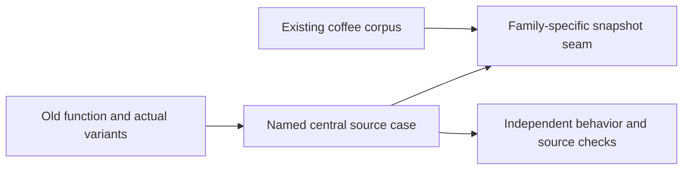

# Sample-code snapshot migration

Source plan: [Notion](https://app.notion.com/p/3f6a9915a6aa816dab64f6304b90175a).
Baseline: cleanup commit `f7e9352`; no removed migration tests were restored.

`inventory.txt` preserves the plan's 363 function names (58 files), not a case count.
`test_source_migration_manifest.py` checks that every name has a destination.
Family manifests expand parameters, languages, helper inputs, metadata modes and
mutation stages. Additional setup found during the source census is in `audit.json`.

## Destinations

| Family | Source/catalog location | Runner | Named snapshots |
| --- | --- | --- | ---: |
| Resolution and adapter probes | `fixtures/cases/resolution/`, `resolution.json` | `test_resolution_snapshots.py` | 313 |
| Imports/indexing and namespace probes | `fixtures/cases/imports/`, `imports.json`, `import_cases.json` | `test_import_snapshots.py` | 107 |
| Parsing and native metadata | `fixtures/cases/parsing/`, `parsing*.json` | `test_parsing_snapshots.py` | 590 |
| Complexity, parameters and physical size | `fixtures/cases/metrics/`, `metric*.json` | `test_metric_snapshots.py` | 209 |
| CLI and stateful operations | `fixtures/cases/cli/`, `fixtures/cases/operational/`, `cli.json` | `test_cli_case_snapshots.py` and scoped transcript fixture | 191 |
| Python architecture snippets | `fixtures/cases/policy/`, `policy.json` | `test_policy_snapshots.py` | 627 |
| Existing coffee source, parser-only metadata | `fixtures/coffee/`, `coffee.json` | `test_coffee_parsing_snapshots.py` | 48 |
| Existing coffee quantitative CLI records | `fixtures/coffee/`, `coffee.json` | `test_coffee_metric_snapshots.py` | 8 |

These 2,093 new baselines supplement the existing coffee graph, Markdown,
check and navigation snapshots; coffee sources are not copied.

## Review and retained contracts

Baselines were checked against the original explicit assertions before adoption.
Policy cases retain independent allowed/forbidden polarity; dependency-scan
snapshots use the original exact expected sets. Resolution/import review traced
original and migrated bytes/projects. Thirteen reordered import inputs were
repaired; seven snapshots changed only by moving existing records. Independent
HEAD-derived source/write-order tests guard the repaired ordering. Three source
selector literals became symbolic IDs, leaving source exclusively in the corpus.
A missing-folder CLI case now runs from its isolated temporary cwd; its error
snapshot contains no checkout-specific path.

Deterministic outputs are snapshot-covered, not substitutes for operational
properties. Original cache/lifetime/nonmutation, mock dispatch and call counts,
error propagation, cold-process budget, filesystem/save/fresh behavior, rollback,
transaction isolation, source verification and source-length/AST provenance checks
remain. Source-grounded coffee and receiver/namespace invariants remain independent
of baseline equality. Production-only architecture scans and synthetic graph/model
unit tests remain separate. Setup-only cases do not invent analysis snapshots.

Record/list ordering, null/optional fields, evidence, diagnostics, ownership,
byte spans, invalid UTF-8, CRLF and language-specific negative cases are preserved.
Only volatile roots, timestamps and storage-generated identities are normalized.
`test_source_snapshot_fixture.py` independently guards CRLF loading fidelity.
No automatic baseline rewriting occurs during tests.

## Inventory/storage corrections

The static map included source-free target/production-policy checks and omitted
some helper-derived variants. Each family records its actual sources and retained
checks; `audit.json` additionally maps three model-validation tests using the
previously omitted `ModelsTest.artifact` source helper. The policy's exact public
config AST template is also loaded from the corpus.

Git cannot track a `.git` path component. One metadata decoy is therefore stored
as `git-metadata/bad.py` and materialized as the original `.git/bad.py`; `cli.json`
records both paths. Ignored `node_modules`, `dist` and temporary-file decoys are
tracked explicitly. All 1,906 corpus files were compared with their staged Git
blob hashes: zero omissions or byte changes. `.gitattributes` disables text/EOL
conversion for the new byte-exact corpus. No tested path or source bytes are dropped.

The new corpus is intentionally invalid, ambiguous or oversized in places.
Atlas discovery, Pyright and Ruff exclude it as input data, not executable test
harness code. Atlas also excludes the new derived snapshot JSON; analyzing those
2,093 generated outputs caused a staged-tree cold-process timeout. The original
15-second budget and whole-project code-analysis assertions remain unchanged. Harness/support files and manifests meet the repository size/depth
limits; oversized input files preserve the existing size-boundary scenarios.
Production implementation and README are unchanged.

## Final validation

`(cd atlas && uv run pytest)`: 3,052 passed, the same 9 migration warnings.
Pyright: zero errors/warnings. Ruff: passed. Full-repository Atlas report:
341 files, 2,442 callables, zero parse errors. The 15-second cold-process test
passes without weakening its assertions. Both independent review rounds approved
the repaired ordering/selectors and portable CLI path; no known inventory gap
remains. No dashboard changes.
