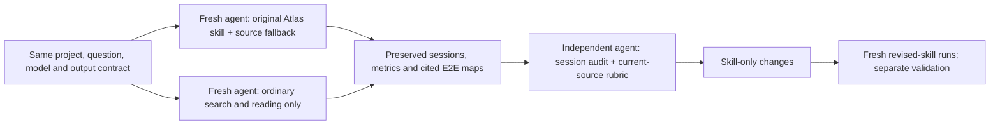
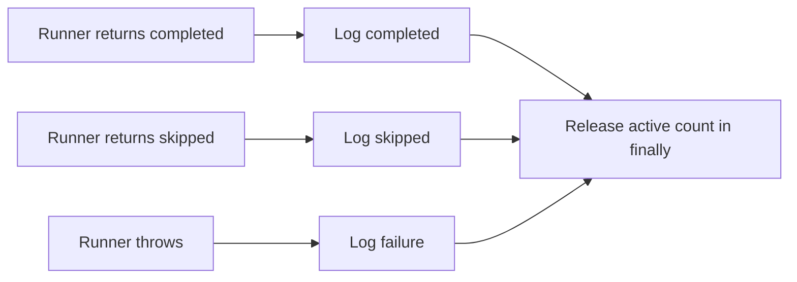

# Atlas skill versus plain navigation: E2E benchmark

## Original-skill result

**Plain navigation was cheaper and faster in every measured pair. Atlas saved a few tool calls overall, but required more model responses. Neither approach demonstrated a source-precision advantage.** This is a small descriptive benchmark, not a general verdict on graph navigation.

| Across three projects | Original Atlas skill | Plain source navigation | Atlas difference |
|---|---:|---:|---:|
| Processed tokens, including cached context | 1,832,100 | 766,810 | +138.9% |
| Uncached input + output tokens | 196,132 | 162,138 | +21.0% |
| Session-rate estimated cost | $0.710541 | $0.504623 | +40.8% |
| Tool calls | 84 | 91 | −7.7% |
| Model responses / roundtrip proxy | 66 | 40 | +65.0% |
| Mean investigation latency | 229.218 s | 164.468 s | +39.4% |
| Supported / wrong / omitted rubric checkpoints | 32 / 0 / 4 | 36 / 0 / 0 | Four additional omissions |
| Rubric precision: supported / (supported + wrong) | 100% | 100% | Tie |
| Rubric completeness: supported / 36 | 88.9% | 100% | −11.1 percentage points |

Precision is not completeness. No substantive source contradiction was found in either condition. These finite rubric scores do not establish that every claim is correct or every behavior covered. The rubric was constructed after seeing the answers, and review was unblinded.

## Projects and questions

Selected from `~/workspace/projects`, with distinct primary implementation languages and different control-flow challenges:

| Label | Project / language | Requested E2E flow | Clean source commit |
|---|---|---|---|
| PY | `atlas` / Python | `atlas index --folder` → discovery → parsing/resolution → SQLite persistence → CLI result, including transaction/failure boundaries | `d317a805197a8d4cf95415f70a2b6336598fa52d` |
| TS | `matato-pi` / TypeScript, also Elixir | Persisted automation config → due-time dispatch → worker execution → completion/result delivery, overlap/error and webhook distinctions | `0bc58465ad37c031e9a86a4e8ffbbb4b905cd0cb` |
| EX | `beer-game-elixir` / Elixir | LiveView player order → validation/persistence → runner/delivery → client refresh, process/message and timing boundaries | `f2d01a1e691cd212188824fc0f306ac0cb025f37` |

TS is deliberately reported as a **mixed-language repository**, not a pure TypeScript parser test. Both agents discovered an independent Phoenix scheduler alongside the standalone Bun worker.



## Method and measurement

Measured on 2026-10-14. Six fresh T3-owned Pi subagents used `openai-codex/gpt-6.1-sol`, thinking `high`, with the same per-project question and output contract: under 900 words, a 6–15-node Mermaid chart, source/line citations, failure semantics and explicit unknowns. They could not delegate, read other sessions/answers, execute application workflows/tests, reindex, or edit source. Each could write only its own answer. Atlas arms read the complete skill and reference; plain arms were forbidden from doing so or using the CLI/database.

The first six native subagents formed an **uninstrumented pilot**: their tool uses `--no-session` and returns answers without usage histories. Those results are excluded, not reconstructed or treated as measured replications. The six measured agents were fresh; neither their prompts nor sessions exposed pilot answers.

All measured agents inherited identical harness/system sections and available-skill metadata. Consequently plain agents saw the skill's name/description/location and shared project instructions mentioning Atlas, but **did not load its body, query Atlas, or inspect the database**. This compares use of the skill/graph, not total ignorance that Atlas exists. Sessions start in this worktree; commands explicitly change into the target checkout and reads use target paths.

The normal database existed but had no project registrations. Preparation used a separate `/tmp/atlas-navigation-benchmark/atlas.sqlite`, explicitly migrated once and indexed each whole project. All three indexes succeeded with zero reported parse errors: PY 16.300 s, TS 5.032 s, EX 1.515 s; total **22.847 s**. Setup/indexing, migration, orchestration startup, pilot and evaluator work are excluded from investigation metrics. A cold first-use comparison would need to charge setup; repeated-task amortization is unknown.

All original arms overlap in time on one host/provider. Revision-pinned graph queries and hash-checked excerpts validate indexed-source identity, not execution. No benchmark answer is a runtime-tested trace. Original skill/reference come from the Atlas commit above; revised runs use only this PR's skill/reference changes.

Definitions, independently recomputed from all six persisted JSONL histories:

```text
processed tokens = Σ usage.totalTokens
                 = Σ (input + output + cacheRead + cacheWrite)
tool calls       = count assistant content entries of type toolCall
model responses  = count persisted assistant messages
latency          = final assistant outer timestamp − first user outer timestamp
estimated cost   = Σ usage.cost.total
```

Reasoning tokens are an output subset; do not add them again. Total tokens count repeated cached context, not unique source text. Cached context is cheaper: recorded rates imply $2/M input, $10/M output, $0.10/M cache read. Dollars are **session-rate estimates, not verified bills**. A model response is a roundtrip proxy, not a count of hidden HTTP retries. Tool calls include prompt/skill reads and answer writes/edits; bash may batch many CLI invocations. Original Atlas used **53 CLI invocations inside 32 bash calls**; none of those CLI invocations failed. Ordinary search failures/no matches are audited separately.

| Pair / arm | Input | Output | Cache read | Total tokens | Tools | Responses | Seconds | Est. USD |
|---|---:|---:|---:|---:|---:|---:|---:|---:|
| PY Atlas | 65,370 | 6,203 | 442,368 | 513,941 | 32 | 18 | 204.898 | 0.237007 |
| PY plain | 55,269 | 4,845 | 222,720 | 282,834 | 27 | 13 | 156.429 | 0.181260 |
| TS Atlas | 54,862 | 7,104 | 784,768 | 846,734 | 33 | 28 | 268.942 | 0.259241 |
| TS plain | 55,923 | 5,414 | 216,576 | 277,913 | 37 | 15 | 179.022 | 0.187644 |
| EX Atlas | 56,565 | 6,028 | 408,832 | 471,425 | 19 | 20 | 213.814 | 0.214293 |
| EX plain | 35,961 | 4,726 | 165,376 | 206,063 | 27 | 12 | 157.953 | 0.135720 |

All cache-write fields are zero. Latencies are per-agent completion times, not summed experiment wall time. Scheduling/load, shared prompt caches, warm filesystem/database caches, nonrandomized launch order and sampling are confounders. There is only one run per condition/project; no confidence intervals or causal/general performance claim is justified.

## What the session and source review found

Python agents both mapped analysis-before-storage, the real `analyze_folder`/`save_folder` route rather than the separate named-project method, normalized graph replacement, rollback and post-commit output. Atlas gave explicit relationship/confidence distinctions and verified source identity, but then performed almost the same broad source reading as plain. Graph orientation did not replace that work.

TypeScript agents both found separate JSON/Croner and Ecto/Quantum paths, process-local overlap control, subprocess/RPC completion differences, monitored status and manual retry. The Atlas agent's focused scheduler context exposed only unresolved `Map` calls, not callback execution; source supplied the actual chain. Plain additionally stated the unconditional fingerprint advance after a failed refresh and the warn-and-continue behavior of failed monitoring registration. Atlas omitted those details without contradicting them.

Elixir agents both found the important nonobvious architecture: timer GenServers only broadcast; connected LiveViews perform CPU ordering/production. Delivery is manual, and order creation is not atomic with the weekly preference update. Plain additionally stated the missing `cpu` predicate and ten-order-per-direction refresh cap; Atlas omitted those details. Both identified UI-only turn gating and post-commit notifications.

Broad searches/context payloads, test-heavy neighborhoods, unresolved callbacks and duplicated source reads increased Atlas output and roundtrips. Serialized returned tool content was 427,357 bytes Atlas vs 298,907 plain (+43.0%); this is not a raw-source or token measure. Harness clipping sometimes hid source following large graph output. Ordinary `rg`/`find` wrapper failures affected both conditions, especially TS Atlas; no-match exit 1 is not the same as a syntax/path failure. One plain pipeline masked a genuine search error. See the independent audit for the distinctions rather than interpreting every flagged tool result as an Atlas failure.

## Skill changes

Only `.agents/skills/atlas-navigate/SKILL.md` and `references/commands.md` change; no installed external skill copy or Atlas implementation changes.

The skill now uses local `overview` identity confirmation instead of obligatory project listing, starts with concrete five-result searches, and reserves `show` for ambiguity. It reads source early, uses depth-1/12-node/30-edge context when needed, and switches a callback/message boundary to source after one unhelpful focused neighborhood. It separates graph payloads from batched text source, avoids rereading verified excerpts, and stops at source-supported start/boundaries/completion/failure. A short checklist covers dispatch predicates, separate commits, state after errors, optional failures, delivery/logging and history caps. The command reference distinguishes no-match from broken searches and warns against clipping or dropping uncertainty metadata.

Database permission/existence guards, exact checkout identity, revision consistency, source hash checks, relationship distinctions and uncertainty reporting remain intact. These are query-strategy changes, not removal of evidence requirements.

## Revised-skill validation

Three fresh revised-skill agents reused the same questions/model/output contract in a **later experiment phase against earlier comparators**, not three new contemporaneous matched pairs. Independent [round-two review](evaluation-revised.md) recomputed their measurements and applied the unchanged rubric. Phase order, warm caches, provider/host load and sampling are confounded; these differences do not establish a causal skill improvement.

| Revised arm | Total tokens | Tools | Responses | Seconds | Est. USD | Supported / wrong / omitted |
|---|---:|---:|---:|---:|---:|---|
| PY | 391,969 | 33 | 19 | 201.082 | 0.202744 | 12 / 0 / 0 |
| TS | 520,842 | 36 | 23 | 164.952 | 0.202191 | 6 / 0 / 6 |
| EX | 342,221 | 17 | 18 | 173.005 | 0.187978 | 11 / 0 / 1 |
| Total | 1,255,032 | 86 | 60 | 539.039 | 0.592914 | 29 / 0 / 7 |

Versus original Atlas: tokens −31.5%, estimated cost −16.6%, tools **+2.4%**, responses −9.1%, latency −21.6%. Versus earlier plain: tokens **+63.7%**, estimated cost **+17.5%**, tools −5.5%, responses **+50.0%**, latency **+9.2%**. Mean revised latency was 179.680 s; only TS was faster than plain. Totals sum per-agent latencies, not concurrent wall time.

**Coverage was not preserved.** Revised rubric completeness is 29/36 (80.6%), versus original Atlas 32/36 and plain 36/36. Python retained all twelve checkpoints and Elixir gained the history cap, but TypeScript compressed the separate OTP runtime to a paragraph: RPC failure/timeout distinctions, startup/validated-record details, refresh fingerprint failure, manual retry, monitored UI completion and registration failure were omitted. This is an actual competing explanation for its apparent efficiency improvement, not merely a hypothetical limitation.

Rubric precision remains 100% on stated checkpoints, but the reviewer found a separate **wrong TS diagram label**: skipped work flows into “Log completed.” Raw measured maps in `evidence/` are deliberately unchanged; the source-correct outcome segment is:



That distinction is supported by `matato-pi/worker/index.ts:12–17` and `worker/scheduler.ts:60–68`. The raw Python map also has a discovery citation ending before the sorted read loop; its complete supporting span is `atlas/atlas/src/atlas/parsing/discovery.py:178–200`. No substantive revised prose contradiction was found; this does not make the answers error-free or complete.

Two agents invented unsupported `graph find --path`; the benchmarked wording “narrow by path” was ambiguous. After review, final skill text explicitly uses positional path-query text, reinforces per-runtime completion coverage, and preserves completed/skipped/failed labels. **These final clarifications are unbenchmarked.** The exact measured revision is retained in [evidence/skill-measured/](evidence/skill-measured/); `provenance.json` keeps separate original, measured-revision and final hashes. Do not assign the observed follow-up savings to the unmeasured final text.

## Deferred Atlas code opportunities — not implemented

| Candidate for later investigation | Observed motivation | Required next evidence |
|---|---|---|
| Closure/callback and indirect-dispatch coverage | `createScheduler` focused context only exposes unresolved Map calls despite meaningful scheduling source | Determine whether callable containment, query choice or resolution is responsible; extend production-pipeline sample snapshots before fixing |
| Production/test scoping and smaller task-focused neighborhood output | Broad runner contexts contain many test callers and clip tool output | Compare supported filters/query strategy with a compact-output/scoping design; retain diagnostics, boundaries and relationship evidence |
| Output-budget-aware source/metadata presentation | Large context output hides later source; source batches require rereads | Distinguish CLI byte limits from harness clipping and test bounded multi-source presentation |

These are hypotheses, not confirmed resolver bugs or requirements. The benchmark does not isolate CLI design from skill query choice and harness behavior. **No Atlas Python, dashboard or parser code was modified.**

## Evidence and reproduction

[evaluation-original.md](evaluation-original.md) is the independent evaluator's full session audit, 36-checkpoint source rubric, citation/diagram review, failure classification and session hashes. It is a snapshot written before the skill revision; its “not implemented” recommendations refer to that point in time. All nine raw measured maps and the measured skill snapshot are in [evidence/](evidence/). [metrics.json](metrics.json) records all nine session-derived rows with session basenames/hashes; [prompts.json](prompts.json) contains their exact inner prompt bodies; [provenance.json](provenance.json) records checkout/setup and skill hashes. Raw session histories stay local, not in Git; published identifiers/hashes allow the owner to audit them without publishing full source/tool transcripts.

To repeat: use the recorded clean checkouts, prepare a separate indexed database, launch fresh equal-model agents with the paired task/output constraints above and the outer wrapper `Read <arm>.prompt.txt and perform exactly that investigation. Start by cd <target checkout> for project commands. Do not inspect other benchmark artifacts. Write the requested answer and return it.`, preserve their sessions, and calculate metrics using the definitions above. Keep plain arms away from the skill body/CLI/database and keep all arms away from prior answers. Count individual CLI commands separately from bash calls. Score the same source checkpoints before interpreting deltas; use multiple randomized repetitions for general conclusions.

## Checks

Importer `uv run pytest` (1,822 passed), `uv run pyright` (zero errors/warnings), and `uv run ruff check .` passed. Whole-worktree `uv run --project atlas atlas report --f .` completed successfully. No dashboard/UI code changed; dashboard build/tests and browser smoke checks were not run. Final JSON arithmetic/provenance, relative Markdown links, per-file line limits, CLI example and `git diff --check` validations passed. Measured flow diagrams were source-reviewed, not Mermaid-rendered.
