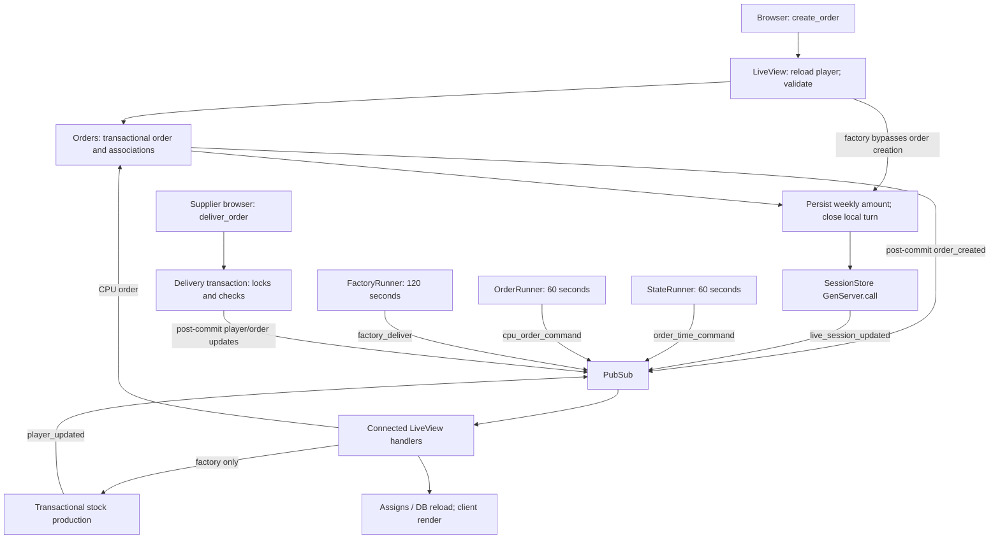

# Player order lifecycle

Orders are persisted synchronously inside the submitting LiveView process. Independent GenServers broadcast timing commands; **connected LiveViews**, not those runners, perform CPU ordering and factory production. Delivery is a separate supplier click, not a scheduled shipment.

## Submission and persistence

The form sends `create_order` with `amount`; its submit button appears only for non-factories with `@order_time`. The handler reloads the player from the DB, navigating home if absent. Validation casts the amount through the integer `weekly_orders` field and checks required player fields. Invalid input flashes “Invalid order amount.” There is **no server-side order-time check, positivity validation, or one-order-per-turn enforcement** in this path. Sources: `lib/beer_game_web/live/board_live/show.html.heex:39–60`; `lib/beer_game_web/live/board_live/show.ex:97–138`; `lib/beer_game/game/player.ex:5–25`.

For retailer/wholesaler submissions, `Orders.create_orders` locks all board players in ID order within `Repo.transact`, finds the submitting player and its supplier, inserts a `PLAYER_ORDER`, and creates buyer `RECEIVING` / supplier `SENDING` associations. Suppliers are retailer→wholesaler→factory. Orders default to `PENDING`. Missing participants or insert failures return errors; association broadcasts occur only after successful transaction completion. The UI maps every creation error to “Supplier is unavailable.” Sources: `lib/beer_game/orders.ex:56–87,135–158`; `lib/beer_game/game/order.ex:5–17`; `lib/beer_game_web/live/board_live/show.ex:114–130`.

Factory submission skips order creation and changes weekly production. Following success, weekly amount is updated separately, then session/local `order_time` becomes false. **These writes are not one transaction with order creation**: a weekly-player update error silently returns the old player, yet closes the turn. Sources: `lib/beer_game_web/live/board_live/show.ex:114–130`; `lib/beer_game/boards.ex:51–56,92–101`.

## Processes and timing

Application supervision starts PubSub, SessionStore and three runners with `:one_for_one`. Each runner independently receives periodic `:work`: StateRunner opens ordering every 60,000 ms; OrderRunner requests CPU orders every 60,000 ms; FactoryRunner requests production every 120,000 ms. No immediate initial command or coordinated phase barrier is shown. Sources: `lib/beer_game/application.ex:10–30`; `lib/beer_game/runners/state_runner.ex:4–17`; `lib/beer_game/runners/order_runner.ex:4–17`; `lib/beer_game/runners/factory_runner.ex:4–17`.

Connected Show LiveViews subscribe to global topics. Their handlers open their session’s turn, create CPU demand for their player, or produce stock if factory. CPU demand creates a sender-only `CPU_ORDER` and updates the next demand amount transactionally. Production locks the factory and adds `weekly_orders` immediately. Handler return values are ignored for CPU/production failures. Consequently, these actions depend on connected views; multiple views can repeat effects rather than being deduplicated per player/tick. Sources: `lib/beer_game_web/live/board_live/show.ex:9–19,64–85`; `lib/beer_game/orders.ex:91–115,168–178`; `lib/beer_game/boards.ex:103–117`.

## Delivery and refresh

Pending outgoing orders expose a delivery button when stock suffices. Clicking invokes `Orders.deliver_order` directly. The transaction locks the order, checks sender authorization and pending status, validates participants, locks players in sorted ID order, checks stock, debits sender, credits receiver and records `last_order`, then marks `DELIVERED`. CPU orders have no receiver. Missing/invalid IDs, unauthorized senders, repeated delivery, invalid/missing participants, insufficient stock or update errors return failure; the UI shows “Order cannot be delivered.” No shipment delay or automatic retry is implemented here. Sources: `lib/beer_game_web/live/board_live/show.html.heex:102–130`; `lib/beer_game_web/live/board_live/show.ex:104–108`; `lib/beer_game/orders.ex:89`; `lib/beer_game/order_delivery.ex:7–109`.

After successful delivery, PubSub broadcasts updated players/orders. Views replace matching existing orders and update their own player. Creation notifications directly append only the supplier’s outgoing order. Session writes use synchronous `GenServer.call`, then broadcast session updates; views re-read session identity and reload DB-backed player/order lists, including incoming orders. Sources: `lib/beer_game/order_delivery.ex:23–33`; `lib/beer_game_web/live/board_live/show.ex:23–42,57–62,140–173`; `lib/beer_game_web/live_session.ex:24–38`; `lib/beer_game/live_session_store.ex:9–30`.

## Unknowns and evidence limits

Actual timer alignment, mailbox interleavings, browser delivery latency and deployed connection counts are unknown; no runtime/tests were executed. Session state is in-memory, so persistence across process restarts is not established (`lib/beer_game/live_session_store.ex:1–16`). Atlas revision `49a1a70d98cc4ba090b5de41f5a4449d` had no reported parse diagnostics. Searches/context were capped and contained unresolved targets; behavior above was verified from complete, hash-checked source excerpts, plus current application source. Some tool output was truncated and relevant excerpts were reread. No command/tool failures occurred.
