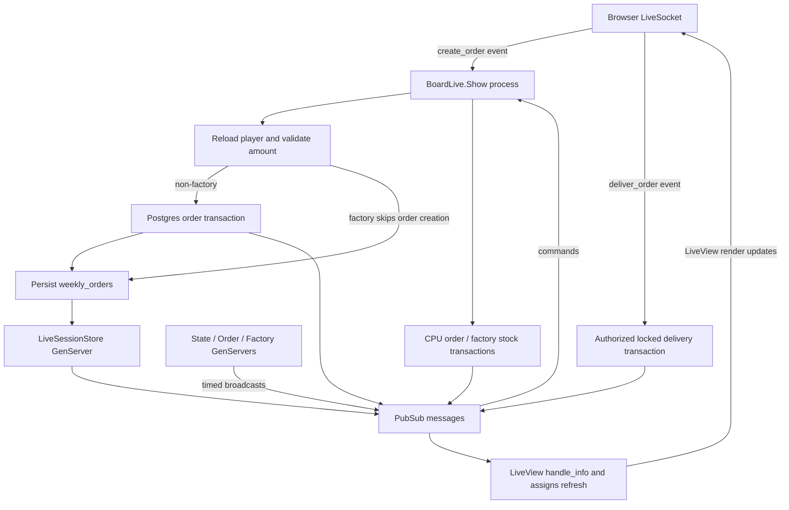

# Player order lifecycle

Source paths below are relative to `/home/leon/workspace/projects/beer-game-elixir`. Citation shorthand: `Show` = `lib/beer_game_web/live/board_live/show.ex`; `Template` = its `show.html.heex`; `Orders`, `Boards`, `Delivery` = `lib/beer_game/{orders,boards,order_delivery}.ex`; runner paths are under `lib/beer_game/runners/`.

## Submission and persistence

The browser connects a Phoenix `LiveSocket` to `/live`; the endpoint supplies signed-cookie session information (`assets/js/app.js:1–14`; `lib/beer_game_web/endpoint.ex:7–14`). The form submits `amount` through `phx-submit="create_order"`. Its submit button appears only for non-factories when `@order_time` is true (`Template:39–60`).

`Show.handle_event` reloads the player from Postgres through `with_player`; missing players navigate home. It casts `amount` into the integer `weekly_orders` field using `Player.changeset`. Invalid input flashes “Invalid order amount.” Validation is casting/required fields, **not positivity** (`Show:97–101,111–115,133–138`; `lib/beer_game/game/player.ex:5–12,22–26`).

For non-factories, `Orders.create_orders` locks all board players in ID order, finds the requester and supplier, then atomically inserts a pending `PLAYER_ORDER` plus requester `RECEIVING` and supplier `SENDING` associations. Supplier routing is retailer → wholesaler → factory. Thus the supplier, not requester, sees the outgoing delivery action (`Orders:56–87,135–145`; `lib/beer_game/game/order.ex:5–17`). Missing supplier/player or insert failure returns an error; the UI maps all such errors to “Supplier is unavailable.” Broadcasts occur after successful transaction completion (`Show:114–131`; `Orders:71–85,150–153`).

Factory submission skips order insertion and changes production quantity instead. Successful submission separately updates `weekly_orders`, stores player/session state, and sets `order_time=false`. This is **not one transaction with order creation**: a weekly-update error returns the old player silently, yet submission still closes ordering (`Boards:92–101`; `Show:117–130`). The handler does not enforce `order_time`, so UI gating alone does not prevent repeated/off-turn events (`Show:97–101,114–131`).

## Runner boundaries and timing

Three separately supervised GenServers broadcast commands, rather than executing board simulation directly (`lib/beer_game/application.ex:11–30`). `StateRunner` opens ordering every 60 seconds; `OrderRunner` requests CPU orders every 60 seconds; `FactoryRunner` requests production every 120 seconds. Their timers begin at initialization, with no explicit phase coordination, turn counter, or all-player barrier (`state_runner.ex:9–17`; `order_runner.ex:9–17`; `factory_runner.ex:9–17`).

Connected Show processes subscribe to global topics and perform the actual work on receipt. Each CPU command calls `create_cpu_orders` for its player, without checking the `cpu` flag. That transaction locks the player, inserts a `CPU_ORDER` with only a `SENDING` association, and advances CPU demand data; initial demand comes from weekly orders at role selection (`Show:12–17,64–86`; `Orders:91–114,124–129,162–180`; `lib/beer_game_web/live/board_live/player_selection.ex:59–69`). Factory commands add current `weekly_orders` to factory stock under a player lock (`Boards:103–117`). Consequently disconnected players receive no work from these handlers; multiple connected Show instances for one player can each execute a tick. CPU/production error returns are ignored by these handlers (`Show:71–86`).

## Delivery and client refresh

Delivery is manual and immediate: the outgoing button sends an order ID when pending and sufficiently stocked; there is no scheduled shipment delay (`Template:107–127`; `Show:104–109`; `Orders:89`). The delivery transaction casts/locks the order, authorizes the supplied player as `SENDING`, requires `PENDING`, verifies association cardinality and same-board participants, locks players in sorted order, and checks stock. It subtracts sender stock, adds receiver stock/sets `last_order` for player orders, and marks `DELIVERED`; CPU orders have no receiver (`Delivery:7–20,36–108`). Errors roll back the transaction and become “Order cannot be delivered”; repeated delivery fails the pending check. Player/order broadcasts follow commit (`Delivery:23–33`; `Show:104–109`).

PubSub messages enter LiveView mailboxes. Creation handlers append only matching `SENDING` orders; order updates replace existing entries, and player updates refresh only the current player. Receiving orders therefore are **not appended by creation messages** (`Show:28–42,57–62,167–172`). Session writes cross a synchronous `GenServer.call` boundary and broadcast `live_session_updated`; Show then rereads persisted player/board/orders, taking ten orders per direction, and assigns data for browser rendering (`lib/beer_game_web/live_session.ex:24–38`; `lib/beer_game/live_session_store.ex:9–30`; `Show:23–26,140–165`). Requester submission normally triggers this fuller refresh.

## Unknowns and investigation limits

Runtime timer ordering, connected-tab counts, broadcast loss/recovery, and actual deployment topology remain unverified. The factory form has no submit button; keyboard submission behavior was not tested. No project code/tests ran; investigation used only listing/search/reading. No commands or tools failed. Only this requested output file was written.
