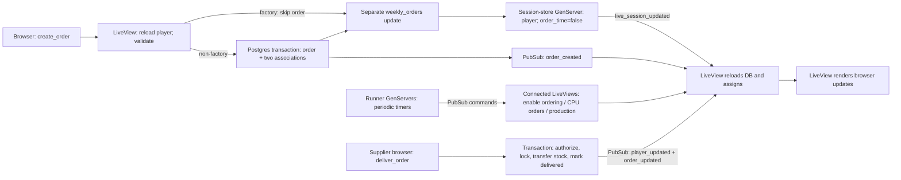

# Player order → delivery → client refresh

Submission runs in the player’s LiveView process, not a game-runner process. Runners broadcast periodic commands; connected LiveViews perform CPU-order creation and factory production. Delivery is a separate, manual event.

The `order_created` edge summarizes refresh: that handler only appends **sending** orders; session messages trigger full reloads.

## Submission and persistence

`/board/:id` routes to `BoardLive.Show`; the browser connects a `/live` LiveSocket. The form sends `create_order` with `amount`. Its submit button appears only for non-factories when `@order_time` is true, but the server handler does **not** enforce turn eligibility or prevent repeat submissions. Factory submissions, if sent, change production quantity without creating an order. Sources: `lib/beer_game_web/router.ex:25`; `assets/js/app.js:7-13`; `lib/beer_game_web/live/board_live/show.html.heex:39-60`; `lib/beer_game_web/live/board_live/show.ex:97-138`.

`with_player` reloads the player, redirecting home if deleted. `Player.changeset` casts `weekly_orders` as an integer and validates required fields; there is no positive/minimum quantity validation. Invalid input flashes “Invalid order amount.” Order validation likewise requires amount/type without a positivity check. Sources: `lib/beer_game/game/player.ex:5-25`; `lib/beer_game/game/order.ex:5-17`; `lib/beer_game_web/live/board_live/show.ex:111-138`.

For non-factories, `create_orders` uses `Repo.transact`, locks board players ordered by ID, resolves retailer → wholesaler or wholesaler → factory, then inserts one `PLAYER_ORDER` and receiver/sender associations atomically. Orders default to `PENDING`. Missing player/supplier or insert errors return an error; association broadcasts occur only after success. The LiveView collapses creation errors into “Supplier is unavailable.” Sources: `lib/beer_game/orders.ex:56-87,135-152`; `lib/beer_game/game/order.ex:7`.

The subsequent weekly-order update is **outside** that transaction. Success stores the updated player in the session; update failure silently returns the old player. Either way, submission’s success branch clears session/local `order_time`. Thus a committed order can survive a failed weekly-order update. Sources: `lib/beer_game/boards.ex:51-56,92-101`; `lib/beer_game_web/live/board_live/show.ex:122-129`.

## Timing and process boundaries

Three supervised GenServers independently schedule messages: StateRunner every 60 seconds broadcasts `order_time_command`; OrderRunner every 60 seconds broadcasts `cpu_order_command`; FactoryRunner every 120 seconds broadcasts `factory_deliver`. There is no shared turn counter or ordering barrier. Sources: `lib/beer_game/application.ex:10-30`; `lib/beer_game/runners/state_runner.ex:9-17`; `lib/beer_game/runners/order_runner.ex:9-17`; `lib/beer_game/runners/factory_runner.ex:9-17`.

Connected Show LiveViews subscribe globally. Each command reloads its player: ordering sets session eligibility true; CPU creation transactionally inserts a sending-only `CPU_ORDER` and advances demand data; factory production locks the factory and adds `weekly_orders` to stock. CPU/production results are ignored by these handlers. Therefore work depends on connected subscribers; multiple tabs can repeat it, while absent subscribers do no work. Sources: `lib/beer_game_web/live/board_live/show.ex:9-19,64-85`; `lib/beer_game/orders.ex:91-115,168-178`; `lib/beer_game/boards.ex:103-118`.

## Delivery and observable completion

Delivery has no timer/shipping delay: the supplier clicks a pending order with sufficient displayed stock. Server-side delivery casts/locks the order, authorizes its sending association, requires `PENDING`, validates participant cardinality and board membership, locks players in ID order, and checks stock again. One transaction deducts sender stock, adds receiver stock/sets `last_order`, and marks `DELIVERED`; CPU orders have no receiver. Errors roll back and flash “Order cannot be delivered,” including unauthorized, already-delivered, malformed/missing participants and insufficient stock. Sources: `lib/beer_game_web/live/board_live/show.html.heex:107-136`; `lib/beer_game_web/live/board_live/show.ex:104-108`; `lib/beer_game/order_delivery.ex:7-109`.

After commit, PubSub sends player/order updates. LiveViews replace their own player and existing order entries. Submission also synchronously calls the in-memory session-store GenServer, which broadcasts session changes; recipients reload DB state. Reloaded histories take ten per direction; live sending-order appends are uncapped. Sources: `lib/beer_game/order_delivery.ex:23-30`; `lib/beer_game/live_session_store.ex:9-30`; `lib/beer_game_web/live_session.ex:24-38`; `lib/beer_game_web/live/board_live/show.ex:23-41,57-61,140-172`.

## Unknowns and tool limitations

Actual timer alignment, scheduling latency, concurrent-tab behavior and browser receipt were not runtime-tested. No durable replay/acknowledgement is shown; post-commit notification exceptions cannot undo committed writes. Session state is in-memory, not transactional with Postgres.

Atlas confirmed this project/revision with no diagnostics; inspected Atlas sources were hash-verified. Broad finds and the depth-one context were truncated; callback/message gaps were resolved from source. One command failed: `graph find --path` exited 2 because that option is unsupported; retry without it succeeded. No project code/tests were run or files changed.
