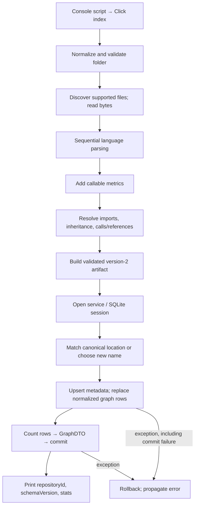

# `atlas index --folder …`: execution map

Indexing first builds a complete, validated graph in memory, then atomically replaces the folder’s stored graph (or registers and saves a new repository). The CLI prints a summary, not the graph.

## Entry and discovery

The console script is `atlas.cli:main`; the package exports the Click group. `index` accepts `-f`, `--f`, or `--folder`, defaulting to `.`. Its actual route is `analyze_folder` → `save_folder`, **not** `RepositoryService.index(project_name, root)`. It expands/resolves the path, analyzes before opening storage, and converts selected exceptions into `ClickException`. Sources: `atlas/pyproject.toml:22–24`, `atlas/src/atlas/cli/__init__.py:3`, `atlas/src/atlas/cli/commands.py:11–34`, `atlas/src/atlas/services/repositories.py:27–29,87–94`.

`analyze_repository` validates that the resolved root is a directory; Git is unnecessary. Discovery walks directories, reads recognized files in sorted order, and retains root-relative POSIX paths plus raw bytes. A root `.gitignore` enables inherited/nested Git ignore rules; otherwise built-in exclusions apply, including directory names containing `generated`. Nested `.atlasignore` rules always apply. `.git` and files resolving outside the root are excluded. Filename detection uses the language-pack catalog, explicitly excluding C/C++. Sources: `atlas/src/atlas/indexer.py:29–33`, `atlas/src/atlas/parsing/discovery.py:24–28,56–75,106–155,158–200`.

## Parsing and resolution boundaries

`parse_files` is sequential and returns no partial repository if a parser raises. Each file gets a SHA-256 of its original bytes; parsing uses replacement-decoded UTF-8. Tree-sitter syntax extraction and separate native `process()` supply calls, imports and recursive declarations/inheritance. Dedicated extraction adapters coexist with generic fallback. Syntax errors become diagnostics for dedicated adapters; generic fallback suppresses that diagnostic. Callable metrics use retained source, adding line/parameter counts and complexity before resolution. Sources: `atlas/src/atlas/parsing/parser.py:105–149,151–222`, `atlas/src/atlas/parsing/adapters/__init__.py:7–26`, `atlas/src/atlas/metrics/callables.py:10–35`.

Resolution constructs repository-local symbol, syntax, module, import-binding, callable-identity and receiver indexes. It resolves imports, then inheritance, then calls; lexical scope, imports, package membership and receiver/member policies constrain matches. Dedicated resolution policies have a conservative generic fallback. Unresolved/ambiguous targets become deduplicated external nodes—not proof of third-party dependencies. Calls retain their extracted relationship (`CALLS` versus `REFERENCES`) with `INFERRED` confidence; imports distinguish resolved `INFERRED` from unresolved `EXTRACTED` and retain `typeOnly`. Sources: `atlas/src/atlas/metrics/resolver.py:87–140,154–207,271–356,469–526`, `atlas/src/atlas/metrics/adapters/__init__.py:48–71`.

Artifact construction adds containment/hierarchy, source metadata, diagnostics, dependency views/metrics, import-cycle groups, statistics and a UTC timestamp. Schema version is 2; validation checks unique keys and parent/edge references. `analyze_folder` converts the dataclass to a dictionary. Sources: `atlas/src/atlas/metrics/artifact.py:28–76,313–349,420–512`, `atlas/src/atlas/services/repositories.py:27–29`.

## Persistence, return and failure semantics

`repository_service` composes service → repository store → SQLAlchemy session without implicit migration. SQLite uses `DATABASE_PATH`, otherwise the user-data directory; connections enable foreign keys and a 30-second busy timeout. Opening storage can create its directory/database, but indexing does not initialize the schema. Sources: `atlas/src/atlas/services/factories.py:26–30`, `atlas/src/atlas/persistence/repositories.py:53–57`, `atlas/src/atlas/persistence/database.py:18–44,68–78`.

`save_folder` matches canonical local locations, ignoring URL registrations; otherwise it chooses an available basename/suffixed name. Storage ends orchestration reads with rollback, then saves. New registration and graph commit together. `_save` validates parentage, upserts metadata with a fresh UUID revision/import timestamp, deletes old edges/nodes/diagnostics, and inserts normalized node/file/symbol/metric/decorator/edge/diagnostic rows. Node-dependent rows cascade on deletion. This stores normalized facts, not the complete artifact: views/cycle groups and dependency metrics are not serialized here. Sources: `atlas/src/atlas/services/repositories.py:71–85`, `atlas/src/atlas/persistence/repositories.py:107–164`, `atlas/src/atlas/persistence/models.py:65–121`, `atlas/src/atlas/persistence/graph_records.py:51–178`.

The row-count-based `GraphDTO` is constructed before commit and returned only after commit succeeds. Any save exception rolls back, preserving the prior graph and avoiding partial registration. Analysis failure occurs before database opening. SQLAlchemy errors become `RepositoryError`; CLI catches `OSError`, `ValueError`, `RuntimeError`, and `RepositoryError`, not every possible parser/resolver exception. Output contains only `repositoryId`, `schemaVersion`, and `stats`. Sources: `atlas/src/atlas/persistence/repositories.py:125–148`, `atlas/src/atlas/persistence/graph_queries.py:31–52`, `atlas/src/atlas/persistence/database.py:69–78`, `atlas/src/atlas/cli/commands.py:23–34`.

## Evidence limits and unknowns

Atlas revision `2341804570ab45f6ab0226e8c77fb425` selected the exact registered checkout. Queried source excerpts were hash-verified; ordinary current-source reads filled graph gaps. Name search and depth-2 context were truncated, with unresolved targets and depth/node boundaries; graph absence was not treated as behavioral absence. Runtime performance, concurrent-index races, external grammar internals and actual failure behavior remain untested. No indexing/tests were run. One `rg` command exited 2 because guessed paths `atlas/src/atlas/discovery.py` and `atlas/src/atlas/graph` did not exist; investigation continued at the actual paths. Atlas commands succeeded.
