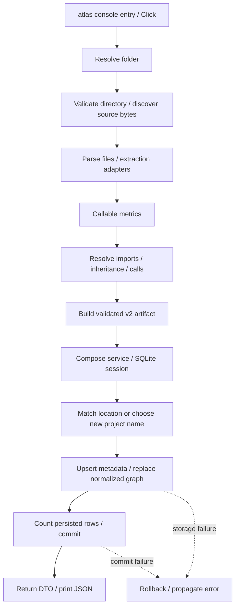

# `atlas index --folder …`: end-to-end map

Read-only source investigation in `/home/leon/workspace/projects/atlas`; no project code or tests executed. Citations below are repository-relative.

## Entry and analysis boundary

The installed executable targets `atlas.cli:main` (`atlas/pyproject.toml:22–24`), re-exported by `atlas/src/atlas/cli/__init__.py:1–5`. Click’s `index` accepts `-f`, `--f`, or `--folder`, defaulting to `.`. It expands/resolves the path, calls `analyze_folder`, then opens `repository_service` and saves. Successful output is JSON containing only `repositoryId`, `schemaVersion`, and `stats` (`atlas/src/atlas/cli/commands.py:16–34`). This is **not** the separate project-name-based `RepositoryService.index` route.

`analyze_folder` converts the dataclass artifact to a dictionary without opening a database (`atlas/src/atlas/services/repositories.py:27–29`). The pipeline is directory validation → discovery → sequential parsing → callable metrics → relationship resolution → artifact construction (`atlas/src/atlas/indexer.py:12–33`). Analysis failure therefore cannot overwrite a stored graph or register a new project.

## Discovery, parsing, relationships

Git is unnecessary: validation requires a resolved directory. Discovery recognizes the language-pack catalog except C/C++, detects language by basename, and reads supported files as raw bytes in sorted path order (`atlas/src/atlas/parsing/discovery.py:23–29,56–75,158–203`). A root `.gitignore` enables nested Git rules; otherwise built-in directory exclusions and names containing `generated` apply. Nested `.atlasignore` rules always apply. `.git` and files resolving outside the root are excluded (`atlas/src/atlas/parsing/discovery.py:90–155`).

Extraction uses dedicated adapters for Python, JS/TS variants, Java, Kotlin, Go, Rust, Elixir and PHP, with a generic supported-language fallback (`atlas/src/atlas/parsing/adapters/__init__.py:7–26`). Each parsed file hashes original bytes, replacement-decodes invalid UTF-8, optionally builds a shared syntax tree for extraction, invokes language-pack native `process`, and produces calls, imports, recursive symbols and inheritance records. Syntax spans use one-based lines/columns; native structure is combined with syntax extraction. Parsing is sequential, and exceptions abort the batch (`atlas/src/atlas/parsing/parser.py:1–5,42–63,105–226`). Dedicated adapters record concrete syntax errors; generic adapters suppress that diagnostic. Syntax errors do **not** automatically abort indexing (`atlas/src/atlas/parsing/parser.py:174–200`).

Callable enrichment adds line counts, complexity and parameter counts for functions/methods from retained source (`atlas/src/atlas/metrics/callables.py:10–36`). Resolution has an independent dedicated-policy registry and conservative generic fallback (`atlas/src/atlas/metrics/adapters/__init__.py:48–71`). Repository-wide file/symbol, syntax, module, import-binding, callable-identity and receiver indexes support lexical/import/package and qualified-member lookup (`atlas/src/atlas/metrics/resolver.py:271–356,437–531`). Resolution emits imports, inheritance, then calls. Unsafe/unresolved targets become deduplicated external module/type/callable nodes; edges retain confidence, location and evidence (`atlas/src/atlas/metrics/resolver.py:70–207`).

Artifact construction adds repository/directory/file/symbol/external nodes, containment and resolved edges, hierarchy, dependency views/metrics, import-cycle groups, UTC metadata and statistics. Pydantic validates schema-v2 fields, unique keys and parent/edge references; parse diagnostics contribute to `parseErrors` (`atlas/src/atlas/metrics/artifact.py:28–102,313–348,420–506`).

## Persistence, transaction and result

Service composition hides repositories/sessions and **never migrates implicitly** (`atlas/src/atlas/services/factories.py:26–30`). SQLite uses `DATABASE_PATH`, otherwise `$XDG_DATA_HOME/atlas/atlas.sqlite` or `~/.local/share/atlas/atlas.sqlite`; engine construction creates the parent directory. Connections enable foreign keys, a 30-second busy timeout and explicit `BEGIN`. WAL is configured by explicit migration, not ordinary indexing (`atlas/src/atlas/persistence/database.py:18–78`).

`save_folder` matches canonical local locations, ignoring URL registrations. Existing projects retain their ID; otherwise the root basename is uniquified with numeric suffixes (`atlas/src/atlas/services/repositories.py:71–85`). Storage ends orchestration-read transactions before writing. New registration and graph save are atomic. `_save` validates parentage, upserts metadata with a fresh revision/import time, deletes old edges/nodes/diagnostics, inserts normalized node/file/symbol/metric/decorator/edge/diagnostic rows, computes the DTO, then commits; exceptions roll back (`atlas/src/atlas/persistence/repositories.py:107–164`). Child detail rows cascade on node deletion; parent references are deferred and edge endpoints constrained (`atlas/src/atlas/persistence/models.py:39–143`). No whole artifact blob, dependency views or cycle groups are written by this path (`atlas/src/atlas/persistence/graph_records.py:51–178`). Returned statistics are counted from stored rows, not copied from artifact statistics (`atlas/src/atlas/persistence/graph_queries.py:31–57`).

SQLAlchemy errors become `RepositoryError`; the CLI wraps that plus `OSError`, `ValueError` and `RuntimeError` as `ClickException`. Other exception types may escape. Output happens after commit, so output failure cannot undo the save (`atlas/src/atlas/persistence/database.py:68–78`; `atlas/src/atlas/cli/commands.py:23–34`).

## Unknowns and command failures

Native grammar internals/download behavior, per-language resolution completeness, actual installed migration state, and concurrent registration behavior remain unverified. Location/name selection precedes the write transaction; no retry is evident in this path. Runtime/crash recovery was not tested.

Two command failures occurred: `rg --files` was rewritten to incompatible `grep` (exit 2); compound `find` predicates were rejected by the `rtk` wrapper (exit 1). Explicit `/usr/bin/find` and `/usr/bin/grep` succeeded. Some search outputs were truncated; targeted reads/searches supplied the cited evidence.
