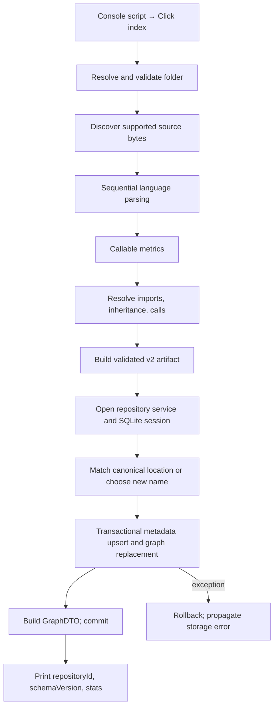

# `atlas index --folder …`: end-to-end map

Indexing analyzes the folder entirely in memory, then atomically replaces its registered SQLite graph. Success prints a JSON summary, not the full artifact. All source paths below are relative to `/home/leon/workspace/projects/atlas`.

## Entry and analysis

The package’s console script targets `atlas.cli:main`; `cli/__init__.py` exports the Click group. Its `index` callback accepts `-f`, `--f`, or `--folder` (default `.`), expands/resolves the path, calls `analyze_folder`, and only afterward enters `repository_service`. This CLI does **not** call `RepositoryService.index(project_name, root)`. (`atlas/pyproject.toml:22–24`; `atlas/src/atlas/cli/__init__.py:1–5`; `atlas/src/atlas/cli/commands.py:11–34`.)

`analyze_folder` converts the returned dataclass artifact to a dictionary. `analyze_repository` orders validation → discovery → parsing → callable metrics → relationship resolution → artifact construction. Validation requires a directory, not a Git repository. (`atlas/src/atlas/services/repositories.py:27–29`; `atlas/src/atlas/indexer.py:12–33`; `atlas/src/atlas/parsing/discovery.py:54–73`.)

Discovery uses `os.walk`. A root `.gitignore` enables inherited/nested Git rules; otherwise built-in directory exclusions and directory names containing `generated` apply. `.atlasignore` always applies; `.git` and files resolving outside the root are excluded. Sorted recognized files become root-relative `SourceFile` records with raw bytes. Filename-based language-pack detection accepts its catalog except C/C++. (`atlas/src/atlas/parsing/discovery.py:24–28,100–157,178–190`.)

Parsing is sequential. Each file gets a raw-byte SHA-256; replacement-decoded UTF-8 feeds Tree-sitter syntax and separate native `process` extraction. Adapters extract calls, imports, declaration hierarchy, inheritance, and positions. Dedicated extraction policies cover Python, JS/TS variants, Java, Kotlin, Go, Rust, Elixir, and PHP; other supported grammars use a generic fallback. Callable metrics subsequently enrich functions/methods from retained bytes. (`atlas/src/atlas/parsing/parser.py:151–225`; `atlas/src/atlas/parsing/adapters/__init__.py:7–27`; `atlas/src/atlas/metrics/callables.py:10–36`.)

Resolution builds repository-wide syntax, module, import-binding, callable-identity, and receiver views. Names use lexical scope, imports, package scope, and restricted language-family fallback; qualified calls consult receiver/member policies. Independent resolution adapters have conservative generic fallback. Edges retain evidence and confidence: resolved imports are `INFERRED`, unresolved imports `EXTRACTED`, inheritance/call edges `INFERRED`; import `typeOnly` survives. Unresolved or ambiguous targets become deduplicated external nodes—not necessarily third-party dependencies. (`atlas/src/atlas/metrics/resolver.py:80–200,271–360,508–527`; `atlas/src/atlas/metrics/adapters/__init__.py:48–71`.)

The v2 artifact adds repository/directory/file/symbol/external nodes, containment, hierarchy, dependency views/metrics, import cycles, UTC indexing metadata, statistics, and diagnostics. Validation checks unique keys and parent/edge references. (`atlas/src/atlas/metrics/artifact.py:27–75,313–348,420–510`.)

## Persistence, delivery, and failures

Service/storage factories provide a repository-backed service without implicit migrations. SQLite selects `DATABASE_PATH`, otherwise the user-data location; connections enable foreign keys and a 30-second busy timeout, with explicit `BEGIN`. Schema migration is separate. (`atlas/src/atlas/services/factories.py:26–30`; `atlas/src/atlas/persistence/database.py:18–45,48–78`.)

`save_folder` updates the first canonical-location match, skipping URL registrations. Otherwise it chooses the folder basename and collision suffixes, then calls `save_new`: registration and graph save share one commit, unlike standalone `register`. Prior orchestration reads are rolled back before writing. (`atlas/src/atlas/services/repositories.py:71–85`; `atlas/src/atlas/persistence/repositories.py:60–80,107–123`.)

`_save` validates parentage, upserts metadata with a fresh revision/import timestamp, deletes old edges/nodes/diagnostics, and inserts normalized nodes, files, symbols, metrics, decorators, edges, and diagnostics. Node deletion cascades to subordinate records. It builds a count-based `GraphDTO` before committing; any exception rolls back replacement and new registration. Artifact views/cycle aggregates are not directly stored. (`atlas/src/atlas/persistence/repositories.py:125–164`; `atlas/src/atlas/persistence/models.py:67–134`; `atlas/src/atlas/persistence/graph_queries.py:31–58`.)

Analysis exceptions occur before database opening, preserving existing graphs. Syntax errors generally become persisted diagnostics rather than aborting; generic extraction suppresses its syntax-error diagnostic. Parser exceptions abort the batch. SQLAlchemy failures become `RepositoryError`; the CLI wraps listed filesystem/validation/runtime/repository errors as `ClickException`. Other exception types can escape. JSON printing occurs **after commit**, so output failure cannot undo persistence. (`atlas/src/atlas/parsing/parser.py:151–225`; `atlas/src/atlas/persistence/database.py:69–78`; `atlas/src/atlas/cli/commands.py:23–34`.)

## Evidence limits and tool failures

Graph revision `2341804570ab45f6ab0226e8c77fb425`, indexed `2026-10-14T10:08:16.580391+00:00`, had no overview diagnostics. The initial `index` search and entry neighborhood were truncated; several call targets were unresolved. Direct current-source reads filled those gaps. Runtime concurrency/crash outcomes, native language-pack internals, and complete per-language semantic accuracy remain unverified; no indexing/tests were run.

Failures: `graph find --path` exited 2 (unsupported option); `rg --files` was rewritten to incompatible grep and failed. The batched graph-source display was clipped despite an `ok` entry status; ordinary file reads supplied complete relevant source. No reindexing or repair was attempted.
