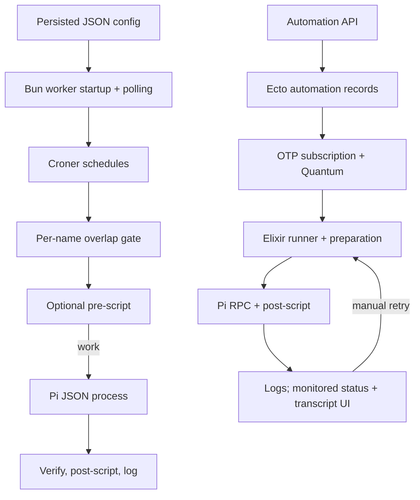

# Scheduled automation: two independent execution paths

The repository implements a standalone Bun worker over JSON configuration and an OTP/Quantum scheduler over database records. Neither inspected path selects persisted “due” rows: cron libraries own due-time callbacks. They must not be mistaken for one shared queue.

## Standalone worker

Actual launch is `bun worker/index.ts` (`package.json:26`). Startup constructs scheduler/watcher, installs SIGINT/SIGTERM handlers, and immediately starts polling (`worker/index.ts:10–37`). Configuration comes from `MATATO_PI_AUTOMATIONS_CONFIG`, otherwise package-relative `config/config.json`; this differs from `MATATO_PI_CONFIG`, the runtime/session storage directory. Missing JSON means an empty automation list; malformed input propagates. Legacy defaults are `canOverlap=false`, `useSkill=true` (`src/automationConfig.ts:9–29`; `src/storagePath.ts:4–13`).

Watcher polls immediately and every five seconds, prevents concurrent polls, and replaces schedules only when normalized JSON differs. Repeated identical reload errors are logged once; unsuccessful reloads retain the previous content/schedules (`worker/watcher.ts:21–57`). Replacement first builds paused Croner jobs with five-or-six-part cron syntax, rejects duplicate names, omits disabled jobs, and rejects enabled monitored jobs. A failed build stops its partial jobs before throwing; successful replacement stops old schedules and resumes new ones (`worker/scheduler.ts:15–44,71–80`).

Dispatch uses an in-memory active count keyed by job name. With overlap disabled, an already-active name is silently skipped, not queued; other names can execute concurrently. Allowed overlaps increment the count. Errors are logged and counts released in `finally`; no retry/backoff or durable dispatch ledger appears here (`worker/scheduler.ts:52–68`). Counts survive schedule replacement within the same process, not restarts.

Runner optionally resolves a skill and executes `preScript.ts`; trimmed empty output skips Pi and post-script. Otherwise it invokes `pi --mode json --print --approve` with configured model/thinking/prompt. Subagents are restricted using `PI_SUBAGENT_DEPTH=1` unless allowed. Optional daily sessions use local-date IDs and the storage sessions directory (`worker/runner.ts:12–49,61–147`).

Completion requires successful process exit plus complete JSON records, an `agent_settled` event, and a final assistant message stopping with `stop` or `length`. Then optional post-script runs. The worker logs completed/skipped or failed; its output parser validates rather than forwarding assistant text to a recipient (`worker/piOutput.ts:16–51`; `worker/index.ts:12–18`). Spawn/nonzero-exit errors reject. Shutdown aborts subprocess groups with SIGTERM, escalating after five seconds to SIGKILL (`worker/process.ts:15–84`).

## Web application

OTP application startup supervises automation scheduler/subscription (`web-app/lib/web_app/application.ex:10–18`; `web-app/lib/web_app.ex:14–24`; `web-app/lib/web_app/automations.ex:12`). `/api/automations` CRUD persists Ecto records and broadcasts changes; records validate cron syntax and constrain unique names (`web-app/lib/web_app_web/router.ex:28–35`; `web-app/lib/web_app_web/controllers/automation_controller.ex:18–47`; `web-app/lib/web_app/automations.ex:43–105,134`; `web-app/lib/web_app/automations/record.ex:5–58`).

Subscription loads records on startup, refreshes on PubSub changes, and checks a fingerprint every second. Quantum replacement validates/builds before deleting previous jobs; enabled jobs dispatch `Runner.run`, with `can_overlap` passed to Quantum. Refresh failures are logged (`web-app/lib/web_app/automations/subscription.ex:14–45`; `web-app/lib/web_app/automations/scheduler.ex:7–48`). Quantum’s internal due-time/overlap behavior was not inspected.

Runner prepares the skill, skips empty pre-script output, optionally registers a monitored session, and runs Pi RPC. Execution waits for settlement, returns assistant text or failure, closes the port, and executes post-script only after successful Pi execution. Unlike the standalone parser, RPC treats `length` as failure; its receive loop has no explicit timeout (`web-app/lib/web_app/automations/runner.ex:6–73`; `web-app/lib/web_app/execution.ex:6–20,77–94,158–193,214–259`).

Monitored runs get a session file and stored working record, then settled/failed status and PubSub notification. The run UI reloads status/transcript; failed runs offer manual retry through `Automations.run`/`Task.start`, outside the scheduled Quantum dispatch gate. Unmonitored completion is logged; returned response text is discarded by the runner (`web-app/lib/web_app/sessions/registry.ex:55–79,130–132,314–337`; `web-app/lib/web_app_web/live/automation_run_live.ex:8–26,46–60,102–130`; `web-app/lib/web_app/automations.ex:15`).

## Unknowns and investigation limits

No webhook field/route was found in inspected automation types/router or the webhook search; these are recurring cron timers, not demonstrated webhook automations. JSON-to-Ecto synchronization, deployed process topology, cron timezone/missed-fire behavior, cross-process dedupe, and guaranteed external notification delivery remain unverified.

Atlas revision `e5b5215ec38f4c2ba58ed01efe8f3094` stayed consistent; cited Atlas source excerpts were hash-verified. Broad searches/neighborhood output were truncated; a focused scheduler context exposed only an unresolved `Map` call, so source reading filled callback/graph gaps. No code/tests ran. Command failures: `rg --glob` was rejected by the grep-backed command; `ls systemd` and a search of absent `web-app/lib/mix/tasks` failed; no-match searches returned exit 1 and stopped chained commands. No reindexing occurred.
