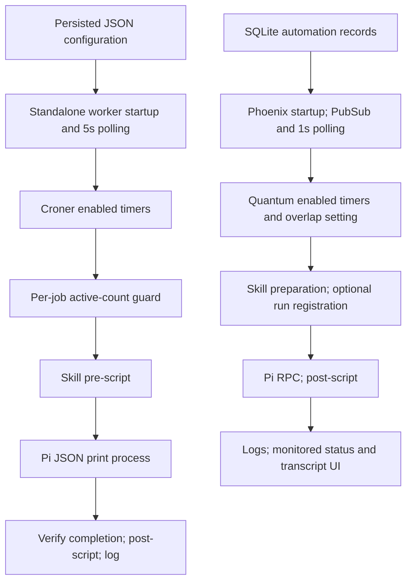

# Scheduled automation: two independent execution paths

The repository contains a standalone TypeScript worker and a Phoenix/Quantum scheduler. They do **not** share configuration loading or a deduplication guard.

## Standalone worker

The actual entry point is `bun worker/index.ts` (`package.json:23–29`). It wires watcher → scheduler → `runAutomation`, logs outcomes, and starts polling (`worker/index.ts:10–24,36–37`). Configuration comes from `MATATO_PI_AUTOMATIONS_CONFIG`, otherwise package-relative `config/config.json`. Loading parses JSON, defaults `canOverlap=false` and `useSkill=true`, and treats a missing file as an empty automation list (`src/automationConfig.ts:9–30`).

The watcher loads immediately and every five seconds. It prevents concurrent polls, compares serialized configuration, and only replaces schedules after successful loading. Repeated identical reload errors are logged once (`worker/watcher.ts:28–58`). Croner owns due-time selection: five/six-field cron patterns are initially paused, then resumed after replacement. Duplicate names—including disabled entries—are rejected; disabled jobs are omitted; enabled monitoring jobs are unsupported. Invalid candidates are stopped before rethrowing, leaving old schedules intact (`worker/scheduler.ts:15–44,71–80`).

Dispatch uses an in-memory active-count map keyed by `jobName`. With overlap disabled, a busy occurrence is silently dropped, not queued. Counts survive schedule replacement; overlap-enabled runs increment the same counter. Failures are logged and the counter is always released. Different jobs can run concurrently; there is no global capacity limit or cross-process guard here (`worker/scheduler.ts:52–87`).

Execution optionally resolves a skill, preferring the user's skill directory over bundled skills. An optional Bun pre-script runs first: missing means continue, trimmed empty output means skip, other output is appended to the prompt. Pi runs with JSON/print mode, approval enabled, configured model/thinking, and optionally a local-date daily session. Disallowed subagents set `PI_SUBAGENT_DEPTH=1` (`worker/runner.ts:12–48,61–147`).

Success requires process exit zero **and** valid complete JSON records, `agent_settled`, and a final assistant message with stop reason `stop` or `length`. Only then does the optional post-script run. Spawn/nonzero-exit, protocol, and script failures propagate to scheduler logging. The response itself is not returned or automatically pushed: the runner returns only `completed`/`skipped` (`worker/process.ts:24–85`; `worker/piOutput.ts:16–51`; `worker/runner.ts:144–147`; `worker/index.ts:13–17`). SIGINT/SIGTERM stops polling/timers and aborts execution; process groups receive SIGTERM, then SIGKILL after five seconds (`worker/index.ts:26–35`; `worker/process.ts:14–21,54–73`).

## Phoenix path and result delivery

Application supervision installs the database, sessions, scheduler, and subscription (`web-app/lib/web_app/application.ex:10–18`; `web-app/lib/web_app.ex:14–25`; `web-app/lib/web_app/automations.ex:12`). CRUD API routes persist Ecto automation records and broadcast changes. Cron validation and a unique-name constraint apply; production storage is `MATATO_PI_CONFIG/matato-pi.sqlite3` (`web-app/lib/web_app_web/router.ex:28–35`; `web-app/lib/web_app/automations.ex:43–105,134`; `web-app/lib/web_app/automations/record.ex:20–59`; `web-app/config/runtime.exs:30–48`).

Subscription reloads at startup, on PubSub changes, and on one-second fingerprint changes. Quantum selects due times in the configured timezone; enabled jobs call `Runner.run`, with `can_overlap` passed to Quantum. Replacement validates before deleting old jobs; refresh errors log, but the subscription still records the new fingerprint (`web-app/lib/web_app/automations/subscription.ex:14–45`; `web-app/lib/web_app/automations/scheduler.ex:7–51`; `web-app/config/runtime.exs:3–9`). Manual failed-run retry starts a separate task, bypassing Quantum's overlap setting (`web-app/lib/web_app_web/live/automation_run_live.ex:45–57`; `web-app/lib/web_app/automations.ex:15`).

This runner prepares scripts, optionally registers a monitored run, executes Pi RPC, then runs the post-script. RPC settles on `agent_settled`; explicit RPC errors, premature exit, and assistant `error`/`aborted`/`length`/`deferred` fail—unlike standalone acceptance of `length`. No receive timeout is implemented (`web-app/lib/web_app/execution.ex:6–20,77–96,160–193,231–261`).

Monitored runs get a unique JSONL session and SQLite metadata; completion casts update `settled`/`failed` and broadcast to subscribers. The run LiveView reloads status and transcript on changes. Registration failure merely warns and continues unmonitored; skipped preparation creates no run record. Unmonitored execution logs rather than delivering its returned response (`web-app/lib/web_app/automations/runner.ex:6–74`; `web-app/lib/web_app/sessions/registry.ex:55–79,130–133,314–336`; `web-app/lib/web_app_web/live/automation_run_live.ex:8–9,63,88–140`; `web-app/lib/web_app/sessions/transcript.ex:4–17`).

## Unknowns and investigation limits

No webhook implementation was found in `src`, `worker`, `extensions`, or web-app source/config; these are recurring cron timers, not evidenced webhook-triggered jobs. Deployment topology, library-specific missed-tick/DST behavior, Quantum overlap across replacement, and external notification delivery remain unverified. No durable occurrence queue, automatic failed-run retry, or shared execution lock is evidenced in these paths.

Read-only investigation; no project code/tests executed. Initial `rg --glob` search failed because the command invoked grep, which rejected `--glob`. Later webhook grep exited 1 because it found no matches; ordinary file reads/searches otherwise succeeded.
