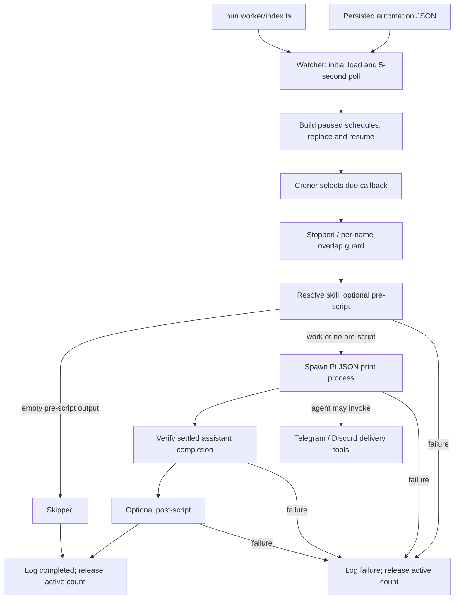

# Scheduled automation: configuration to completion

The standalone TypeScript worker executes recurring cron jobs directly from JSON configuration. It is not a persisted due-job queue, and its result is a completion/skip log—not automatic delivery of the assistant’s answer. A separate Elixir scheduler also exists; these are alternative runtimes, not consecutive stages.

## Entry, persistence and reload

`package.json:20–26` exposes `worker: bun worker/index.ts`. The entry point constructs scheduler/watcher callbacks, starts watching, and passes one abort signal into execution (`worker/index.ts:10–37`). `/automations` is an inspection command, not a dispatcher (`extensions/automations/index.ts:211–232`).

Configuration comes from `MATATO_PI_AUTOMATIONS_CONFIG`, otherwise package-relative `config/config.json`. Loading parses JSON, defaults `canOverlap=false` and `useSkill=true`; missing files become an empty configuration, while other errors propagate (`src/automationConfig.ts:9–29`). This path differs from `MATATO_PI_CONFIG`, used for execution/session storage (`src/storagePath.ts:4–14`).

The watcher loads immediately, then every five seconds. It prevents concurrent polls, compares serialized normalized configuration, and updates its remembered content only after schedule replacement succeeds. Identical consecutive reload errors are logged once; malformed configuration leaves previous schedules running and is retried. A missing file instead successfully removes schedules (`worker/watcher.ts:21–63`).

Replacement first builds paused Croner schedules. Duplicate names—including disabled entries—fail the build; disabled jobs are omitted; enabled `monitor` jobs are rejected. Failed builds stop their newly created schedules before throwing, preserving the old set. Successful builds stop old timers and resume the new set (`worker/scheduler.ts:15–44,71–85`).

## Due selection, concurrency and execution

Croner receives a five- or six-part pattern and directly invokes the captured automation callback; application code has no persisted next-due timestamp, dispatch queue or catch-up loop. The callback returns immediately when stopped, or when the same name is active and overlap is forbidden. Active counts support overlapping runs and are decremented in `finally`, even on failure. Counts survive configuration replacement, but are process-local: no distributed dedupe, global concurrency cap or retry queue is implemented here (`worker/scheduler.ts:15–16,35–38,52–80`). Removing a timer does not abort an already running job.

The runner resolves an enabled skill by job name from user skills first, then bundled skills. Optional `preScript.ts` runs with Bun: missing means continue, trimmed empty output means skip, other output augments the prompt. It supplies model/thinking settings, optional daily session arguments, and `PI_SUBAGENT_DEPTH=1` when subagents are disallowed (`worker/runner.ts:12–90,96–141`).

Pi runs as `--mode json --print --approve`. Spawn errors/nonzero exits reject; stderr retains its last 8,192 characters. Shutdown stops polling/timers and aborts execution, terminating Unix process groups with SIGTERM then SIGKILL after five seconds (`worker/process.ts:15–84`; `worker/index.ts:26–35`).

## Completion and delivery

Success requires newline-complete, parseable JSON, `agent_settled`, and an assistant message whose stop reason is `stop` or `length`; zero process exit alone is insufficient (`worker/piOutput.ts:16–51`). Only then does an optional post-script run. Post-script failure marks the job failed despite prior agent effects; no rollback exists (`worker/runner.ts:143–147`). Exceptions are logged and active counts released; future cron occurrences remain scheduled (`worker/scheduler.ts:60–68`).

The runner returns only `completed`/`skipped`; the entry point logs that status. Assistant text is not forwarded by this pipeline. Telegram/Discord are separate agent-invoked tools, not guaranteed completion callbacks (`worker/index.ts:12–17`; `extensions/telegram/index.ts:6–21`; `extensions/discord/index.ts:6–30`).

## Separate runtime, webhook distinction and unknowns

Elixir persists Ecto automation records and broadcasts successful mutations. OTP starts its Quantum scheduler/subscription; subscription reloads on PubSub changes and one-second fingerprint polling. Quantum receives cron schedules, runner tasks and overlap settings (`web-app/lib/web_app/automations.ex:12–15,44–74`; `web-app/lib/web_app.ex:14–24`; `web-app/lib/web_app/automations/subscription.ex:15–43`; `web-app/lib/web_app/automations/scheduler.ex:7–12,37–44`). Its runner uses RPC execution, optionally completes monitored sessions, and logs success/failure rather than delivering the returned answer (`web-app/lib/web_app/automations/runner.ex:24–74`; `web-app/lib/web_app/execution.ex:15–20`).

No webhook implementation was found in the searched worker/source/extensions/web-app/config paths; the automation type is cron-only and Phoenix exposes automation CRUD, not webhook execution (`src/automation.ts:6–21`; `web-app/lib/web_app_web/router.ex:28–35`). Unknown: which runtime is deployed, actual message delivery, Croner/Quantum timezone and missed-tick behavior, and downstream monitored-session persistence.

Atlas revision `e5b5215ec38f4c2ba58ed01efe8f3094`; inspected TS excerpts were hash-verified, with no diagnostics. Capped searches were incomplete; focused context missed callbacks, so source supplied those boundaries. No code/tests ran. Tool failures: `rg --files` was rewritten to grep and rejected; one `ls` included nonexistent `web-app/lib/web_app/execution`, preventing its chained grep. Ordinary source reads recovered both gaps.
