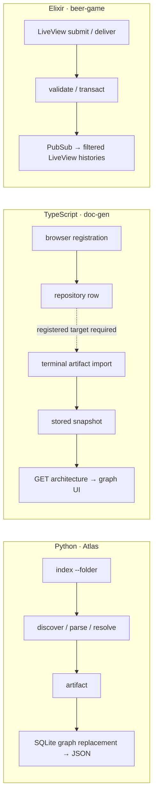

# E2E navigation: Atlas vs Graphify vs plain

2026-10-14 · three projects/languages · nine measured agents + independent session/source auditor.

## Verdict

**Plain: cheapest, fastest overall. Atlas: fewest harness calls. Precision: no clear overall winner.** Graphify: one extra Elixir behavior, cleaner material-diagram audit; Atlas: stronger sampled citations. Findings describe these runs—not universal rankings.

| Strategy | Uncached input + output | Cached input | All tokens | Calls | Navigation time¹ | Reported cost² |
|---|---:|---:|---:|---:|---:|---:|
| Plain search/read | 127,850 | 1,077,888 | 1,205,738 | 75 | 530s | $0.435 |
| Atlas + latest skill | 136,198 | 1,137,280 | 1,273,478 | **59** | 591s | $0.475 |
| Graphify + Pi skill | 208,324 | 1,986,432 | 2,194,756 | 69 | 686s | $0.692 |

¹ Sum of three agent durations, not concurrent batch wall time. ² Pi-reported estimates, not invoice. Cached tokens count toward consumption, usually cheaper than uncached. Plain wins both token definitions. Atlas: 21% fewer calls than plain, but 7% more uncached/output tokens; Graphify: 63% more tokens, 29% more time than plain.

| Project / language | Strategy | Tokens³ | Calls | Seconds | Coverage⁴ |
|---|---|---:|---:|---:|---:|
| Atlas / Python | Plain | **42,311** | 25 | 250 | 12/12 |
| | Atlas | 49,937 | **20** | 260 | 12/12 |
| | Graphify | 56,914 | 22 | **130** | 12/12 |
| doc-gen / TypeScript | Plain | **40,042** | 26 | 200 | 12/12 |
| | Atlas | 48,599 | **18** | **161** | 12/12 |
| | Graphify | 78,307 | 24 | 259 | 12/12 |
| beer-game / Elixir | Plain | 45,497 | 24 | **80** | 11/12 |
| | Atlas | **37,662** | **21** | 171 | 11/12 |
| | Graphify | 73,103 | 23 | 298 | **12/12** |

³ Uncached input + output. ⁴ Twelve source-derived checkpoints/project, scored independently. Coverage ≠ precision.

## Precision / effective calls

Graphify **36/36** coverage; Atlas/plain **35/36**. Only Graphify explicitly traced session notifications reloading incoming Elixir histories. Atlas/plain diagrams incorrectly imply factory production emits order notifications; production emits only `player_updated`. Prose mostly correct across arms. Graphify has a minor TS layout-ownership error; Graphify/plain have sampled TS citation offsets. No defensible true-claim percentage or universal precision winner.

Atlas's 59 harness calls batch **58 graph CLI invocations**; Graphify's 69 contain **24** (including help/save); plain's 75 contain none. Fewer harness calls ≠ fewer underlying operations. Independent audit and benchmark maps (paths normalized): `evaluation.json`, `evidence/`.

## Flows mapped

Python: analysis precedes database opening; normalized graph replacement atomic; stdout failure can occur after commit. TypeScript: registration does **not** index/clone; terminal import is separate, replaces a stored snapshot; UI refresh/cache not live source indexing. Elixir: order creation and weekly/session updates are separate commits; delivery authorization/stock mutation transactional; broadcasts after commit, not durable delivery guarantees. Graph edges alone establish none of these semantics.

Source anchors: Atlas `atlas/src/atlas/cli/commands.py:19-35`, `atlas/src/atlas/persistence/repositories.py:107-164`; doc-gen `src/components/repository-form.tsx:12-23`, `scripts/import-architecture.ts:4-21`, `src/lib/repositories.servers.ts:86-120`, `src/routes/graph.$repositoryId.tsx:19-34`; beer-game `lib/beer_game_web/live/board_live/show.ex:97-176`, `lib/beer_game/order_delivery.ex:7-109`. Paths refer to pinned revisions below, not future HEAD.

## Method / caveats

Same GPT-6.1 Sol, medium reasoning, fresh T3 contexts; one cell each, concurrent shared machine. Identical clean `git archive HEAD` snapshots from `~/workspace/projects`; matched scope, ≤700-word maps, suggested ≤25 investigation calls. All strategies could verify source; plain used filesystem search/read, no navigation skill. Calls include briefing/skill reads, failures, bookkeeping and writes; batching shell commands reduces harness calls without necessarily reducing CLI operations.

Atlas CLI force-reinstalled from current origin HEAD; latest skill reinstalled in existing skill directory. Graphify 0.9.90, isolated venv + Pi skill, directed AST graph, SQL extra, vocabulary expansion/query/path/explain available. Whole-code-corpus profile: **not** full semantic-doc extraction/community naming/visualization. Query/explain used in every arm, path in TS/Elixir; agents skipped reflection, PY/TS skipped save-result. Partial skill adherence, not full-skill efficacy. Python corpus exceeded skill's 500-file narrowing threshold; explicit whole-project setup retained all 727 code files. This is not an unqualified benchmark of the entire Graphify pipeline.

| Project | Revision | Atlas migrate + index | Graphify AST + graph + clustering |
|---|---|---:|---:|
| Atlas | `4d6c0c9505a02044a63d7da2626682ec625ebbbf` | 12.861s | 6.571s |
| doc-gen | `14c4eae6b6d4bf43b66959c574a87235dafcdc0c` | 26.027s | 2.828s |
| beer-game-elixir | `275d51eb1f0e55cd427e7cd9d4e98bd977f31228` | 4.204s | 0.227s |

Graphify revision `fe085cedddde3a18554f8749b230bfe47f3dcce7`. Installation time not instrumented; cold-start totals cannot be claimed. Setup above adds 43.092s Atlas / 9.626s Graphify, excludes installs and semantic work. Native pilot agents discarded sessions (`--no-session`); excluded, replaced by measured T3 agents. Warm filesystem/index caches; pilot Graphify memory not reset, but auditor found no measured consumption. Provider errors: Elixir Graphify four, Python Atlas/plain one each; retries inflate time, unreported consumption unknown. No repeated trials, blind randomized scoring or runtime execution. Python benchmark analyzes Atlas itself; results may not transfer.

Metrics: sum each assistant response's `usage`; all tokens includes cached input; cost sums `usage.cost.total`; calls count `toolCall` blocks; time first user message → final assistant timestamp. Session hashes and per-arm totals in `metrics.json`; source/session audit in `evaluation.json`.

## Cleanup / checks

Graphify checkout, isolated venv/dependencies/download cache, temporary skill, generated graphs/AST caches/memory and benchmark source/index copies deleted after audit. Retained benchmark maps, aggregate telemetry and evaluation—not Graphify graph datasets. No global Graphify installation/hooks/config created.

Report-only PR; no source or README changes. Whole-repository `uv run --project atlas atlas report --f .` passed. Application tests not run: no application changes.
