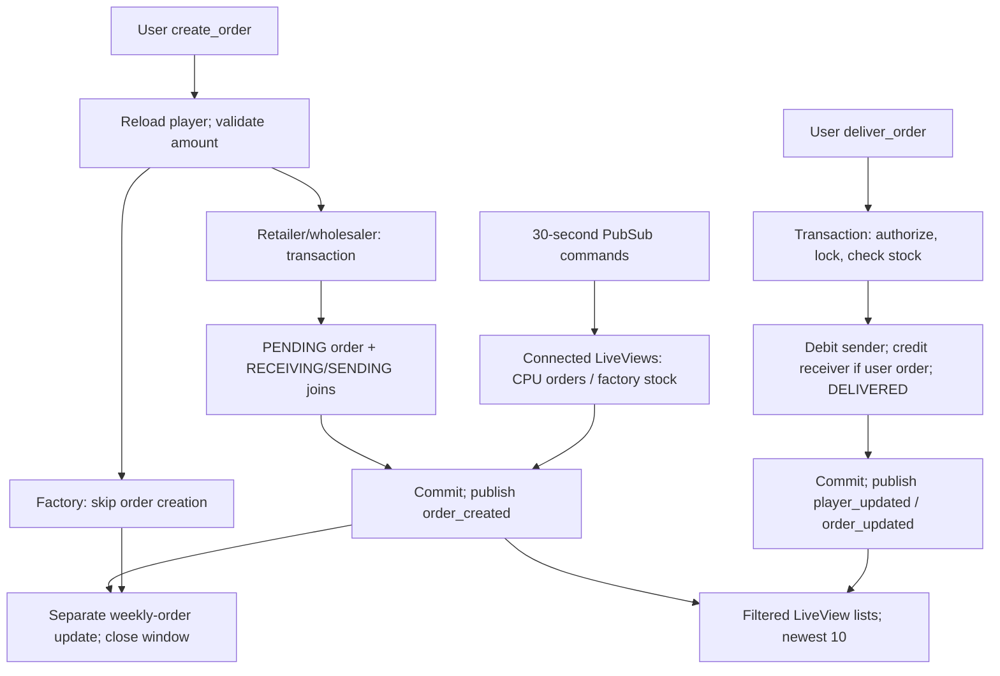

# LiveView order flow

User creation and delivery are separate transactions. Scheduled “factory delivery” produces stock; it does not deliver an order.

## Creation

The form submits `amount`; non-factory submit visibility requires `order_time`, while factory saves production anytime. This is UI gating: the handler does not enforce the ordering window (`lib/beer_game_web/live/board_live/show.html.heex:27-56`; `lib/beer_game_web/live/board_live/show.ex:97-131`). `with_player` reloads the player or navigates home. `Player.changeset` casts integer weekly orders and requires player fields, but imposes no positivity constraint; invalid input flashes “Invalid order amount” (`show.ex:111-138`, same directory; `lib/beer_game/game/player.ex:22-26`).

`Orders.create_orders` locks all board players in ID order, finds the requesting player and supplier (retailer→wholesaler→factory), inserts one `PLAYER_ORDER`, requester `RECEIVING` join and supplier `SENDING` join. Missing player/supplier returns `supplier_unavailable`; insertion errors abort the transaction. Only successful commit broadcasts both joins (`lib/beer_game/orders.ex:56-87,135-152`). Order state defaults to `PENDING`; join rows carry player/order foreign-key associations (`lib/beer_game/game/order.ex:5-18`; `lib/beer_game/game/players_orders.ex:5-18`).

Factory creation skips order/join insertion. After success, weekly orders update separately, then session/window becomes false. A weekly-update error returns the old player, yet closes the window: committed orders remain. Creation’s post-commit `broadcast!` can also fail after persistence (`show.ex:114-130`; `lib/beer_game/boards.ex:92-101`; `lib/beer_game/orders.ex:150-152`).

## Delivery and failure boundaries

The pending outgoing row enables Deliver only with sufficient displayed stock. Server-side delivery independently casts/locks the order, authorizes the caller’s SENDING join, requires PENDING, and validates exact participants: user order has two distinct sender/receiver joins; CPU order only one sender. Players lock in sorted ID order; sender must have a board, receiver must share it. Missing records, unauthorized/repeated delivery, malformed participants or insufficient stock return errors and the LiveView flashes “Order cannot be delivered” (`show.html.heex:108-130`; `show.ex:104-108`; `lib/beer_game/order_delivery.ex:7-100`).

Within one transaction, sender stock decreases; user receiver stock increases and `last_order` becomes amount; CPU has no receiver. Order becomes DELIVERED. Any write error rolls back these writes. After commit, non-bang PubSub broadcasts players then order; their return values are ignored, so persistence is not contingent on notification success (`lib/beer_game/order_delivery.ex:16-34,103-109`). The older nontransactional `Boards.deliver_order` is not this handler’s path (`lib/beer_game/orders.ex:89`; `lib/beer_game/boards.ex:120-133`).

## Scheduled paths and display

Three 30-second jobs publish ordering-window, CPU-order and factory commands (`config/config.exs:13-27`; `lib/beer_game/runners/{state,order,factory}_runner.ex:1-5`). Connected LiveViews subscribe; callbacks reload players, open windows, create CPU orders without checking `player.cpu`, or produce factory stock. CPU transaction inserts one SENDING order and updates demand; factory production adds weekly orders. These callbacks ignore returned failures; effects depend on connected views, potentially multiple tabs (`show.ex:12-16,64-86`; `lib/beer_game/orders.ex:91-115,168-178`; `lib/beer_game/boards.ex:103-118`).

Creation messages add only matching SENDING orders—not RECEIVING. Updates replace only already-listed IDs; player updates match player ID. Session loading reconstructs both lists; normalization deduplicates, sorts descending ID, caps each at 10 (`show.ex:28-42,57-62,140-175`).

Evidence: Atlas revision `8c02c9737ada4cb69342d8b3846ab983`, hash-verified sources; incoming creation context lacked callers, resolved through source. Unknown: actual runtime timing, notification delivery and tab concurrency; application not executed.
