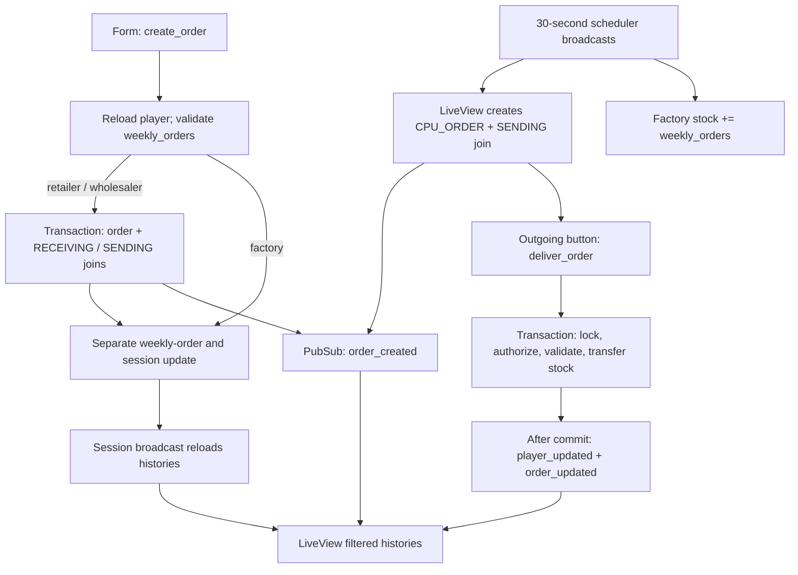

# LiveView ordering and delivery

## User creation

The form submits `amount`; non-factory submit visibility requires `order_time`, while factory saves production (`lib/beer_game_web/live/board_live/show.html.heex:27-56`). This is UI gating, not a server-side ordering-window check. `create_order` reloads the player, redirects if missing, casts `weekly_orders` through the player changeset, and flashes “Invalid order amount” on invalid input (`lib/beer_game_web/live/board_live/show.ex:97-138`). Validation requires integer fields but specifies no positive/minimum quantity constraint (`lib/beer_game/game/player.ex:22-26`; `lib/beer_game/game/order.ex:14-18`).

For non-factories, `create_orders` locks all board players in ID order, locates the requester and supplier (retailer→wholesaler→factory), inserts a `PLAYER_ORDER` and two `player_orders` joins: requester `RECEIVING`, supplier `SENDING`. Orders default to `PENDING`; joins reference player and order (`lib/beer_game/orders.ex:56-87,135-145`; `lib/beer_game/game/order.ex:5-8`; `lib/beer_game/game/players_orders.ex:5-9`). Missing participants or insertion errors return transaction errors; successful associations broadcast only after commit.

Factory submission creates no order. After successful non-factory creation—or factory bypass—the weekly quantity and session are updated separately; ordering closes (`lib/beer_game_web/live/board_live/show.ex:114-130`). A failed weekly-player update returns the old player rather than undoing committed orders, and ordering still closes (`lib/beer_game/boards.ex:92-101`). This is a partial-failure boundary, not one atomic end-to-end operation.

## Delivery

Only pending outgoing rows expose delivery, enabled when displayed stock suffices; the event carries `order_id` and uses the assigned player ID (`lib/beer_game_web/live/board_live/show.html.heex:110-130`; `lib/beer_game_web/live/board_live/show.ex:104-108`).

`Orders.deliver_order` delegates to `OrderDelivery`: cast/lock order, authorize its `SENDING` player, require pending state, validate exact participant shape, then lock players in sorted ID order. Player orders need distinct sender/receiver on the same board; CPU orders need only a sender. Missing players, malformed participants, unauthorized/repeated delivery, and insufficient stock return errors (`lib/beer_game/orders.ex:89`; `lib/beer_game/order_delivery.ex:7-100`). Sender stock decreases; receiver stock increases and `last_order` changes; state becomes `DELIVERED`, all within `Repo.transact`. CPU delivery has no receiver. Returned transactional errors roll back mutations; player/order broadcasts occur after commit, with no rollback/retry for notification failure (`lib/beer_game/order_delivery.ex:9-34,103-109`). The older `Boards.deliver_order` helper is not invoked by this path (`lib/beer_game/boards.ex:120-134`).

## Scheduled CPU/production and UI synchronization

Three configured 30-second jobs broadcast ordering-window, CPU-order, and factory-production commands (`config/config.exs:13-27`; `lib/beer_game/runners/{state,order,factory}_runner.ex:3`). Connected LiveViews subscribe and execute these commands: enable ordering, create CPU demand, or produce stock only for factories (`lib/beer_game_web/live/board_live/show.ex:9-19,64-86`; `lib/beer_game/boards.ex:103-117`). CPU creation atomically inserts `CPU_ORDER` plus one `SENDING` join and advances demand data; no `cpu` flag check appears (`lib/beer_game/orders.ex:91-116,173-184`). No connected automatic order-delivery job was found; factory “deliver” means production.

Creation notifications append only matching `SENDING` rows. Updates replace already-present IDs in either history; player updates filter by player ID. Session broadcasts reload joins, including incoming rows. Histories deduplicate, sort ID descending, and cap at ten (`lib/beer_game_web/live/board_live/show.ex:23-42,57-61,140-176`; `lib/beer_game/live_session_store.ex:25-30`).

Unknowns: runtime job ordering, absent/multiple connected-view effects, and notification-loss recovery were not executed. AST graph connections guided reads; the missing directed submit→creation path did not establish absent runtime invocation.
