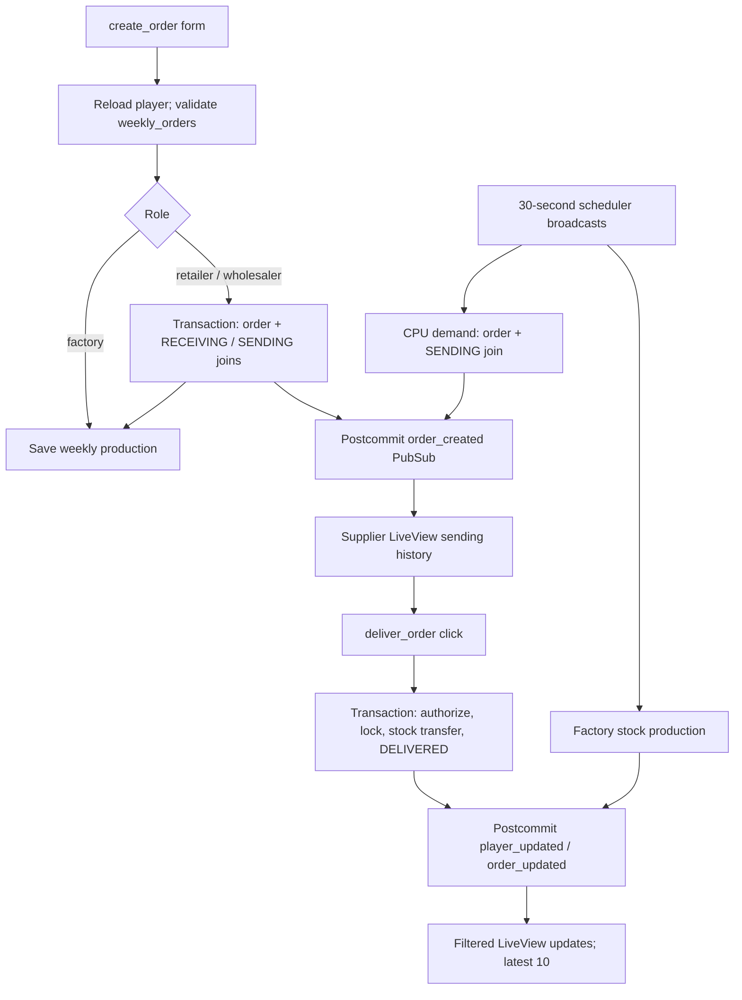

# LiveView order lifecycle

Paths below are relative to `snapshot/beer-game-elixir`.

## User creation

The form submits `amount`; nonfactory submit is visible only during `@order_time`, while factory always saves production (`lib/beer_game_web/live/board_live/show.html.heex:27-57`). `create_order` reloads the assigned player, redirecting if missing, then checks a `Player.changeset` (`lib/beer_game_web/live/board_live/show.ex:97-102,111-138`). Validation casts integers and requires player fields, but imposes no positive-quantity constraint (`lib/beer_game/game/player.ex:22-26`); the handler does **not** enforce the ordering window server-side.

For nonfactories, `create_orders` locks board players in ID order, resolves retailer→wholesaler or wholesaler→factory, inserts a `PLAYER_ORDER`, and inserts requester `RECEIVING` and supplier `SENDING` joins. It creates no supplier record. Missing participants or insert failures return errors inside `Repo.transact`; broadcasts happen only after success (`lib/beer_game/orders.ex:56-87,135-153`). Orders default to `PENDING`; their changeset only casts fields and requires amount/type (`lib/beer_game/game/order.ex:5-18`). Joins belong to player/order and require type (`lib/beer_game/game/players_orders.ex:5-19`).

Factory submission skips order creation. Successful submission separately updates weekly quantity/session and closes the window (`lib/beer_game_web/live/board_live/show.ex:114-130`). This is a partial-failure boundary: weekly update is outside the order transaction, and its failure silently returns the old player (`lib/beer_game/boards.ex:92-101`); committed orders remain.

## Delivery and failures

Outgoing pending rows expose `deliver_order` with order ID only when displayed stock suffices (`lib/beer_game_web/live/board_live/show.html.heex:108-129`). The handler delegates using the session player's ID and flashes a generic error on failure (`lib/beer_game_web/live/board_live/show.ex:104-109`; `lib/beer_game/orders.ex:89`).

`OrderDelivery.deliver` locks the order, casts IDs, requires the caller's `SENDING` join and `PENDING` state, validates exactly two distinct participants for player orders or one sender for CPU orders, and locks players in sorted ID order. Sender must belong to a board; receiver must share it. Missing/invalid participants, unauthorized caller, repeat delivery, or insufficient stock return errors (`lib/beer_game/order_delivery.ex:7-100`). One transaction subtracts sender stock, adds receiver stock and sets receiver `last_order`, then marks `DELIVERED`; CPU delivery has no receiver. Returned write errors roll back these changes (`lib/beer_game/order_delivery.ex:9-20,103-109`). Negative quantities remain unguarded. Postcommit broadcasts are outside rollback protection; no durable retry is shown (`lib/beer_game/order_delivery.ex:23-34`). The older nontransactional `Boards.deliver_order` is not this routed path (`lib/beer_game/boards.ex:120-133`).

## Scheduled paths and display

Three 30-second jobs broadcast window, CPU-demand, and factory-production commands (`config/config.exs:13-27`; `lib/beer_game/runners/{state_runner,order_runner,factory_runner}.ex:1-5`). Connected Show views consume them; CPU generation applies to every current player, not a CPU-flag-filtered role. CPU data starts from weekly orders at role selection; transaction inserts a sender-only `CPU_ORDER` and advances demand (`lib/beer_game_web/live/board_live/player_selection.ex:59-73`; `lib/beer_game/orders.ex:91-129,162-181`). Factory command adds weekly production under lock, not automatic order delivery (`lib/beer_game_web/live/board_live/show.ex:64-86`; `lib/beer_game/boards.ex:103-118`). No connected view means no shown consumer; multiple views can repeat effects.

Subscriptions are global. Creation adds only matching `SENDING` orders—new receiving orders are not immediately appended. Player updates match player ID; order updates replace existing IDs only. Mount reloads both histories; normalization deduplicates, sorts descending IDs, caps each at ten (`lib/beer_game_web/live/board_live/show.ex:9-42,57-62,140-183`). Unknowns: runtime delivery/reconnect reliability, database failures, and actual scheduler execution were not exercised.
