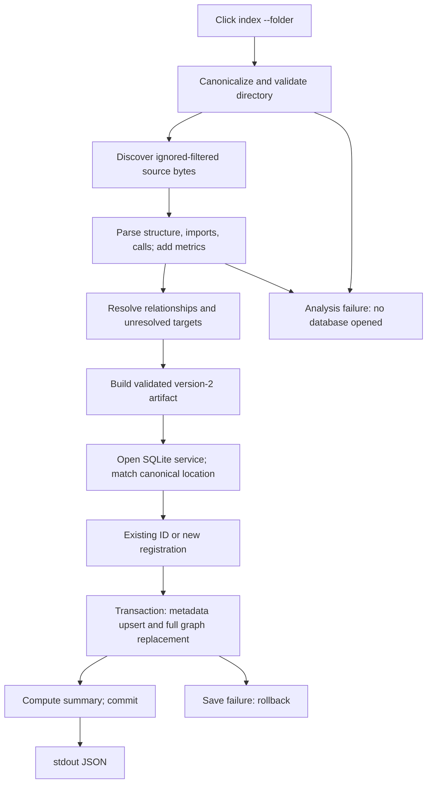

# `atlas index --folder`: end-to-end map

Indexing analyzes the folder entirely in memory, then atomically saves/replaces its latest normalized SQLite graph, then emits a small JSON summary. Git is unnecessary; no application execution is involved.

## Entry and analysis

The console script targets `atlas.cli:main` (`atlas/pyproject.toml:22-23`); `cli/__init__.py:3` reexports the Click group. `index_command` accepts `-f`, `--f`, or `--folder`, default `.`, expands/resolves the path, calls `analyze_folder`, and only afterward opens `repository_service` (`atlas/src/atlas/cli/commands.py:12-35`). `analyze_folder` converts the artifact using `dataclasses.asdict` (`atlas/src/atlas/services/repositories.py:27-29`). Pipeline order is validation → discovery/parsing → callable metrics → resolution → artifact (`atlas/src/atlas/indexer.py:29-33`).

Validation rejects non-directories. Discovery walks without requiring Git, enables nested `.gitignore` only when root `.gitignore` exists, always applies nested `.atlasignore`, otherwise excludes built-in/generated directories, always excludes `.git`, and rejects files resolving outside the root. Recognized language-pack files (excluding C/C++) are read as bytes in sorted path order (`atlas/src/atlas/parsing/discovery.py:24-28,56-75,106-155,171-200`).

Parsing is sequential. Each file gets its raw-byte SHA-256; invalid UTF-8 is replaced for analysis. Shared syntax and native language-pack processing extract calls/references, imports, declaration hierarchy, and inheritance. Dedicated adapters record syntax errors; default-adapter grammar errors are not reported (`atlas/src/atlas/parsing/parser.py:53-63,105-148,174-222`).

Resolution emits imports, inheritance, then calls. Adapters resolve identities; unresolved/ambiguous targets become deduplicated `external:<language>:<kind>:<name>` nodes—not necessarily third-party dependencies. Calls retain their extracted relationship and use `INFERRED`; resolved imports use `INFERRED`, unresolved imports `EXTRACTED`, preserving `type_only`; inheritance requires one matching target (`atlas/src/atlas/metrics/resolver.py:70-140,154-206`). These are static relationships, not execution proof.

Artifact construction adds repository/directory/file/symbol/unresolved nodes, containment, enriched relationships, dependency views/metrics, cycles, diagnostics, counts, and UTC indexing metadata, constructing schema version 2 (`atlas/src/atlas/metrics/artifact.py:27-42,420-506`). File properties retain byte counts/hash; syntax errors become diagnostics (`atlas/src/atlas/metrics/artifact.py:313-348`).

## SQLite, replacement, and result

Service construction does not migrate implicitly (`atlas/src/atlas/services/factories.py:26-30`). SQLite uses `DATABASE_PATH`, foreign keys, a 30-second busy timeout, and explicit `BEGIN`; WAL setup belongs to explicit migration (`atlas/src/atlas/persistence/database.py:18-78`). Canonical location selects an existing registration, skipping URL locations; otherwise basename and collision suffix select a new name (`atlas/src/atlas/services/repositories.py:71-85`).

Storage ends orchestration-read transactions, validates parentage, upserts metadata with a fresh revision, deletes old edges/nodes/diagnostics, and inserts normalized nodes/files/symbols/metrics/decorators/edges/diagnostics. Registration and graph commit together for new repositories. Every save exception rolls back; node deletion cascades dependent rows (`atlas/src/atlas/persistence/repositories.py:107-164`; `atlas/src/atlas/persistence/models.py:64-122`). Summary counts are queried before commit (`atlas/src/atlas/persistence/graph_queries.py:32-53`). After commit, stdout contains only `repositoryId`, `schemaVersion`, and `stats`, not the artifact/revision (`atlas/src/atlas/cli/commands.py:31-35`).

## Failure boundaries and unknowns

Analysis exceptions prevent opening SQLite; parser exceptions abort the batch, while recorded syntax errors permit saving. Save failures preserve the previous graph/no new registration. SQLAlchemy errors become `RepositoryError`; CLI wraps OSError/ValueError/RuntimeError/RepositoryError as Click errors. Other exception types can escape; output failure happens after commit (`parser.py:203-222`, `database.py:68-78`, `cli/commands.py:24-35`, all under `atlas/src/atlas/`).

Unknown: runtime outcomes, concurrent-writer races, and adapter-specific resolution completeness were not executed. Graph revision `a61962f14cee403486ded18382b989a3` matched this checkout; inspected graph-source excerpts were hash-verified. Diagnostics were empty. Bounded neighborhoods/searches were truncated; source verified the relevant boundaries, not exhaustive graph coverage.
