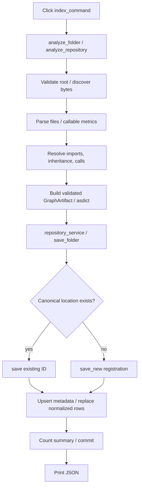

# `atlas index --folder`: end-to-end map

**Evidence boundary.** Graphify retrieved `indexer.py:L1`, `resolve_connections():L111`, and `build_artifact():L420`, including extracted calls from `analyze_repository` into resolution/artifact construction. The broad budgeted query was truncated; a file-seeded call-context query returned only its seed. Graph retrieval supplied navigation, not proof of transaction semantics. The behavior below is supported by local source reads; no application was run or graph rebuilt. Paths are relative to `snapshot/atlas`.

## Entry and analysis

`atlas/pyproject.toml:22-23` maps the executable to `atlas.cli:main`; `atlas/src/atlas/cli/__init__.py:3` exports the Click group. `cli/commands.py:17-35` accepts `-f`, `--f`, or `--folder` (default `.`), expands/resolves the path, analyzes first, then opens storage and saves. Subsequent citations omit the common `atlas/src/atlas/` prefix.

`services/repositories.py:27-29` converts the in-memory artifact with `asdict`. `indexer.py:29-33` sequences root validation → discovery → parsing → callable metrics → relationship resolution → artifact construction.

`parsing/discovery.py:55-74,132-155,175-202` requires a directory, not Git; walks directories, applies nested `.gitignore` only when a root `.gitignore` exists, always applies `.atlasignore`, otherwise uses built-in exclusions (including directory names containing `generated`). It excludes Git metadata/out-of-root resolved files, detects supported languages (C/C++ excluded), sorts paths, and reads bytes.

`parsing/parser.py:151-225` parses sequentially, hashes original bytes, replaces invalid UTF-8, shares syntax where needed, combines language-adapter calls/imports with native processing and structure, and builds symbol/inheritance records. Dedicated-adapter syntax errors become diagnostics rather than aborting indexing.

## Resolution and artifact

`metrics/resolver.py:75-207` resolves imports, inheritance, then calls using repository-wide `CallResolver` and language adapters. Calls originate from their owning symbol or file; unresolved calls become deduplicated external callable nodes. Imports retain external modules; inheritance needs exactly one matching type or becomes external. Edges carry confidence, location, evidence, and applicable type-only information.

`metrics/artifact.py:420-506` builds schema-version-2 repository/directory/file/symbol/external nodes, hierarchy and relationship edges, dependency views/metrics, cycle groups, diagnostics, statistics, languages, and UTC indexing metadata. Construction is validated; missing enrichment endpoints or invalid model fields can fail.

## SQLite and response

`services/factories.py:27-31` composes storage without implicit migration. `persistence/database.py:18-44,69-78` selects `DATABASE_PATH`, otherwise `$XDG_DATA_HOME/atlas/atlas.sqlite` (home fallback), enables foreign keys/30-second busy timeout and explicit transactions, and translates SQLAlchemy errors to `RepositoryError`.

`services/repositories.py:70-86` reuses a repository by canonical local location, skips URL locations, or chooses a collision-free folder-derived name. `persistence/repositories.py:107-173` ends orchestration read transactions, atomically registers new repositories with their graph, validates parentage, upserts metadata/revision, deletes old edges/nodes/diagnostics, and inserts normalized node/file/symbol/metric/decorator/edge/diagnostic rows. Summary counts are computed before commit (`persistence/graph_queries.py:32-53`); every save exception rolls back.

`cli/commands.py:31-35` prints only `repositoryId`, `schemaVersion`, and persisted-summary `stats`, not the full artifact or revision.

## Failure boundaries / unknowns

Analysis failure precedes database opening, preserving existing graphs. Parser/extractor exceptions propagate, unlike recoverable syntax diagnostics. Save failure rolls back replacement and new registration. CLI converts only `OSError`, `ValueError`, `RuntimeError`, and `RepositoryError` to Click errors; unexpected exceptions are not generally wrapped. Output failure occurs after commit and cannot undo storage. Schema migration is explicitly separate. Concurrent registration races, full language-specific resolution completeness, and actual runtime/database compatibility were not tested.
