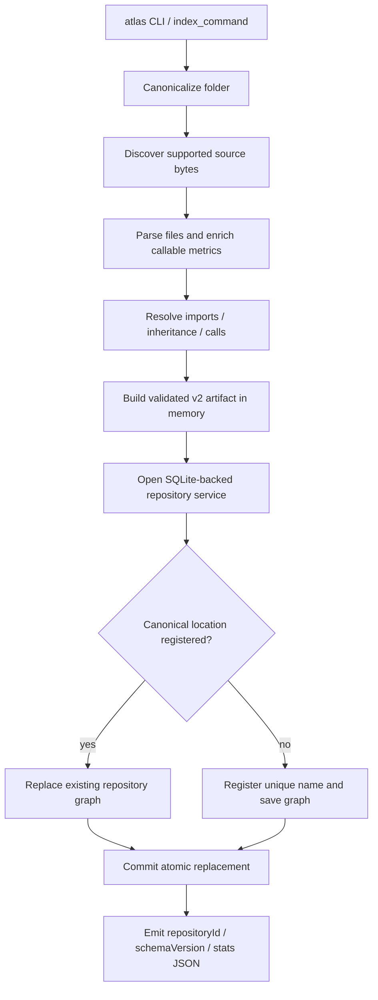

# `atlas index --folder`: source-only trace

Citations are relative to the source project root; no application execution was performed.

## Entry and analysis

The installed entry point is `atlas.cli:main` (`atlas/pyproject.toml:22-24`, `atlas/src/atlas/cli/__init__.py:3`). Click's `index` accepts `-f`, `--f`, or `--folder`, defaulting to `.`. It expands/resolves the path, analyzes **before opening storage**, then saves (`atlas/src/atlas/cli/commands.py:17-29`). `analyze_folder` converts the artifact dataclass to a dictionary (`atlas/src/atlas/services/repositories.py:27-29`). The pipeline is validation → discovery → parsing → callable metrics → relationship resolution → artifact construction (`atlas/src/atlas/indexer.py:12-33`).

Root validation requires a directory, not Git (`atlas/src/atlas/parsing/discovery.py:56-75`). Discovery walks directories; a root `.gitignore` enables inherited/nested Git rules, otherwise built-in directory exclusions and names containing `generated` apply. Nested `.atlasignore` rules independently exclude paths; `.git` is always skipped. Only files resolving inside the root survive. Recognized language-pack filenames are read as raw bytes in sorted order; C/C++ are excluded (`atlas/src/atlas/parsing/discovery.py:24-29,90-155,158-201`).

Parsing is sequential. Each file gets a raw-byte SHA-256; replacement-decoded UTF-8 feeds syntax/native processing. Adapters extract calls/imports and recursive structure, with stable symbol keys and parentage. Dedicated adapters record syntax-error diagnostics rather than aborting; generic adapters suppress that diagnostic. Parser/native/extraction exceptions propagate, so no partial repository is returned (`atlas/src/atlas/parsing/parser.py:105-149,151-225`). Function/method metrics add line counts, parameters and complexity before resolution (`atlas/src/atlas/metrics/callables.py:10-35`).

## Resolution and artifact

The resolver builds repository-local file/symbol/syntax, module, import-binding, callable-identity and receiver indexes (`atlas/src/atlas/metrics/resolver.py:271-285`). It emits imports, inheritance, then calls; unresolved targets become deduplicated external nodes keyed by language/kind/name. Imports retain type-only status and extracted/inferred confidence; inheritance requires one visible type match; call ownership uses the narrowest containing symbol, otherwise the file (`atlas/src/atlas/metrics/resolver.py:87-140,154-239,287-297`). Lexical scope, imports, packages and language-family fallback contribute to named resolution (`atlas/src/atlas/metrics/resolver.py:306-356`).

The artifact contains repository/directory/file/symbol/external nodes, containment plus resolved edges, hierarchy and endpoint metadata, module/file/type/callable dependency views and metrics, diagnostics, import-cycle groups, UTC indexing metadata, and counts. Schema version is 2; validation rejects duplicate keys, missing parents/endpoints and invalid metrics (`atlas/src/atlas/metrics/artifact.py:28-102,262-285,443-506`).

## Storage, replacement and failure boundaries

Canonical local location selects an existing project; otherwise the folder basename gets collision suffixes before atomic registration/save (`atlas/src/atlas/services/repositories.py:71-85`). Service composition never implicitly migrates (`atlas/src/atlas/services/factories.py:26-30`). SQLite uses `DATABASE_PATH`, otherwise XDG/user-data `atlas/atlas.sqlite`; connections enable foreign keys, a 30-second busy timeout and explicit BEGIN (`atlas/src/atlas/persistence/database.py:18-44`).

Storage ends orchestration reads, validates parentage, upserts metadata/new revision, deletes old edges/nodes/diagnostics, inserts normalized records, computes database-backed summary counts, then commits. Any exception rolls back; new registration participates in the same transaction. Node-dependent file/symbol/metric/decorator rows cascade on deletion (`atlas/src/atlas/persistence/repositories.py:107-164`, `atlas/src/atlas/persistence/models.py:65-126`, `atlas/src/atlas/persistence/graph_queries.py:33-54`). Views/cycles are not directly persisted by these row converters (`atlas/src/atlas/persistence/graph_records.py:51-185`).

Analysis failure leaves the previous graph untouched; syntax diagnostics can still save successfully. Missing/unmigrated tables fail rather than auto-migrate. SQLAlchemy errors become `RepositoryError`; the CLI wraps OSError/ValueError/RuntimeError/RepositoryError as Click errors. Other exceptions, such as resolver KeyError, are outside that wrapper. After commit, only `repositoryId`, `schemaVersion`, and persisted `stats` are JSON-emitted; output failure cannot undo the commit (`atlas/src/atlas/persistence/database.py:69-78`, `atlas/src/atlas/cli/commands.py:24-35`).

Unknowns: actual database schema/state, runtime grammar availability, concurrent-writer outcomes, and exhaustive language-specific resolution behavior were not verified.
