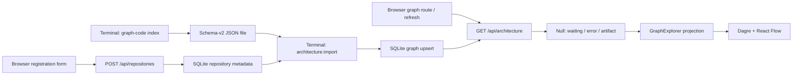

# Registration, offline import, and graph rendering

The browser registers metadata; it does not clone, index, or import. Indexing and importing are separate terminal operations. Current manifest entrypoints use Bun/TypeScript, not a Python subprocess (`package.json:5-23`).

## Browser registration

The home route queries repositories and presents `RepositoryForm`; submission sends `{name, location}` as JSON. Success invalidates `['repositories']` and closes the form; errors appear inline. Location is reference-only (`src/routes/index.tsx:12-20`; `src/components/repository-form.tsx:12-36,53-72`).

POST returns 400 for malformed JSON, otherwise invokes registration and returns 201. Registration trims required strings, limits name/location to 200/4096 characters, generates UUID/time, and inserts metadata. Case-insensitive name uniqueness produces 409; it returns `importedAt: null`. Other unexpected server failures become logged, generic 500 responses (`src/routes/api/repositories.ts:18-29`; `src/lib/repositories.servers.ts:17-48,120-125`; `src/lib/database/schema.ts:10-20`). Listing left-joins graph import timestamps; rows link to `/graph/$repositoryId` and display awaiting/ready status (`src/lib/repositories.servers.ts:50-65`; `src/components/repository-row.tsx:9-28`).

## Separate terminal pipeline and persistence

`graph-code` dispatches `graph_code_ts/cli.ts`: `index` resolves output, calls `indexRepository`, and prints a summary. Analysis validates the repository, discovers/parses files, resolves connections, and builds an artifact; writing validates it, writes a fixed `.tmp`, then renames it. Usage failures return 2, indexing/output failures 1 (`graph_code_ts/cli.ts:102-151`; `graph_code_ts/indexer.ts:31-38,58-65`; `graph_code_ts/artifact.ts:566-584`). Certain parser failures become per-file error facts rather than aborting; later extraction failures can propagate (`graph_code_ts/domain.ts:221-256`).

`architecture:import <graph.json> <id-or-name>` reads JSON locally, validates schema 2, nodes, hierarchy, edges, and cycles, then transactionally resolves exact ID before case-insensitive name and upserts the complete artifact with a fresh import timestamp. Missing repository aborts; validation precedes the transaction. Failed import leaves existing registration/graph intact; success replaces the previous graph, not a history. CLI errors print messages and set exit code 1 (`scripts/import-architecture.ts:4-20`; `src/lib/architecture-artifact.ts:379-419`; `src/lib/repositories.servers.ts:85-117`).

Bun SQLite/Drizzle uses `DATABASE_PATH` or `data/graph-explorer.sqlite`, migrations, WAL, foreign keys, and a process-cached connection. Graphs are JSON text keyed by repository FK (`src/lib/database.servers.ts:8-32`; `src/lib/database/schema.ts:23-29`). Browser/server and importer must target the same database; deployment configuration is unknown.

## Retrieval, rendering, freshness

GET requires `repositoryId` (400), returns 404 for unknown registration, null for registered-but-unimported, otherwise the stored graph (`src/routes/api/architecture.ts:10-22`; `src/lib/repositories.servers.ts:67-82`). Graph query key is `['graph', repositoryId]`, automatic retries disabled. Refresh refetches graph and repository list; null shows import instructions, errors show retry, data renders an explorer keyed by ID/import time (`src/routes/graph.$repositoryId.tsx:15-33,74-95`). Terminal import has no browser invalidation/push; cached data can remain until refetch. Error and retained-data rendering are independently conditional.

Explorer hides tests without mutating storage, projects direct relationships rather than precomputed views, then lazy-loads the canvas. Dagre positions nodes; React Flow renders/selects/opens scopes (`src/components/graph/graph-explorer.tsx:28-55,74-95`; `src/lib/graph-visibility.ts:9-37`; `src/lib/project-graph.ts:186-246`; `src/components/graph/graph-layout.ts:4-40`; `src/components/graph/graph-canvas.tsx:99-170`). Stored artifacts are snapshots, not live source verification. Python wording in waiting UI is legacy guidance, not runtime dispatch (`src/routes/graph.$repositoryId.tsx:115-119`).

Evidence: Atlas revision `aa2ff1cae81d4b1b8323c4179678ce3a`; inspected excerpts hash-verified. Unresolved inferred call targets were checked through imports/source; bounded searches were incomplete, not absence proofs. No application execution; actual deployment, timing, and cache/network outcomes remain unverified.
